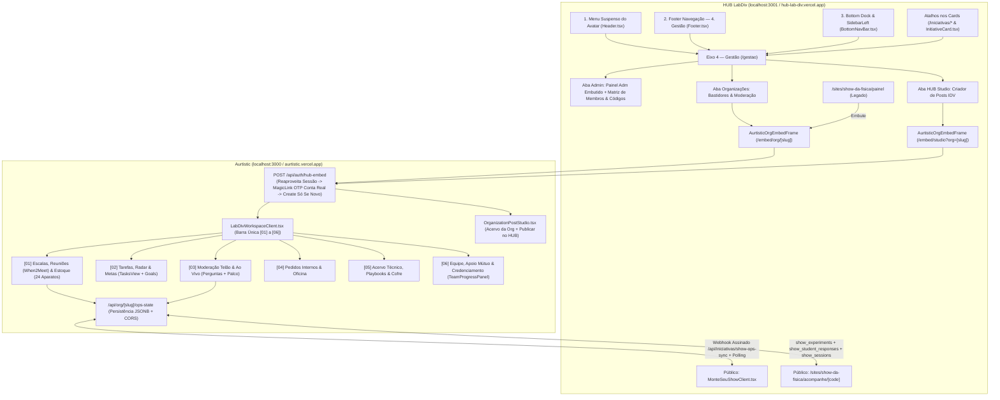

# Plano de Implementação (v4.1 — v2 Revisada): Eixo 4 — Gestão no HUB, Desbloqueio Definitivo de Iframe/CSP & Bastidores Unificados no Aurtistic

> [!IMPORTANT]
> **Revisão Arquitetural (v4.1 — Correção Integral dos 6 Pontos Críticos da v4.0):**
> 1. **[Frente 1 — CRÍTICO] Proteção da Conta Real no SSO (`Aurtistic/src/app/api/auth/hub-embed/route.ts`):** Proibido sobrescrever ou deslogar a conta real do usuário com uma conta espelho `sso_<hubUserId>@aurtistic.local`. O fluxo passa a ter 3 níveis: *(a)* se `supabase.auth.getUser()` já retornar sessão ativa válida para o usuário/e-mail do ticket, reaproveita a sessão atual; *(b)* se não houver sessão ativa e o `email` do ticket já existir no Aurtistic, autentica a **própria conta existente** via `supabaseAdmin.auth.admin.generateLink({ type: 'magiclink', email })` + `verifyOtp({ token_hash, type: 'magiclink' })` server-side; *(c)* só cria novo usuário se o e-mail realmente não existir no banco do Aurtistic.
> 2. **[Frente 1 — CRÍTICO] CSP Bidirecional Completo (`HUB LabDiv/src/lib/proxy.ts` + `next.config.ts` e `Aurtistic/src/proxy.ts` + `middleware.ts` + `next.config.ts`):** Como na sintaxe CSP `http://*.localhost:PORT` **não casa** com `http://localhost:PORT` (sem subdomínio), ambos os formatos são declarados explicitamente junto com `127.0.0.1` e origens `*.vercel.app` em `frame-src`/`connect-src` do HUB e `frame-ancestors` do Aurtistic, garantindo ausência de `X-Frame-Options` bloqueante em `/embed/:path*`.
> 3. **[Frente 2 — CRÍTICO] Sincronia em Tempo Real com "Monte seu Show" e "Telão Ao Vivo":** Persistência real no Supabase do Aurtistic (`organizations.brand_config.operational_state`) + endpoint CORS `/api/org/[slug]/ops-state` no Aurtistic + rota de sincronização assinada `/api/iniciativas/show-ops-sync` no HUB atualizando as tabelas `show_experiments`, `show_experiment_internals`, `show_experiment_availability`, `show_sessions` e `show_student_responses` para que **`MonteSeuShowClient.tsx`** e **`acompanhe/[code]/page.tsx`** reflitam em tempo real o status dos 24 aparelhos e a moderação do telão.
> 4. **[Frente 2] Substituição Unificada sem Duplicidade em `LabDivWorkspaceClient.tsx`:** Fusão de `TasksView`, `TeamProgressPanel` (Apoio Mútuo), `OrganizationScheduleAttendancePanel`, `When2MeetSchedulerGrid`, `OrganizationGoalsPanel`, `OrganizationRequestsPanel`, `OrganizationPlaybooksModal` e acesso ao Cofre/HUB Studio dentro de **uma única barra operacional numerada `[01]` a `[06]`**, aplicando a estética `#000000` + bordas `.neon-border-*` ao `show-da-fisica` e as IDVs oficiais ao `labdiv` e `hs`.
> 5. **[Frente 3] Painel Adm Completo Embutido no Eixo 4 (`/gestao?tab=admin`):** Em vez de links externos estáticos para `/admin`, a aba renderiza diretamente os módulos administrativos reais do HUB (Aprovação de Perfis, Moderação Social/CGIF/Ferramentas, Denúncias, Telemetria, Notificações e Torre Swipe) integrados à **Matriz de Credenciamento de Organizações & Códigos de Convite**.
> 6. **[Frente 4] Acesso ao Eixo 4 nas 3 Superfícies de Navegação:** Inclusão do **Eixo 4 — Gestão** (`/gestao`) no **Menu Suspenso do Perfil (Avatar)** (`Header.tsx`), no **Footer** (`Footer.tsx` — coluna `4. Gestão`) e na **Barra Inferior Flutuante / Navegação Principal** (`BottomNavBar.tsx`, `useUserRoleNavigation.ts` e `SidebarLeft.tsx`).

---

## 1. Arquitetura Alvo & Fluxo de Integração (v4.1)

---

## 2. Frente 1 — Desbloqueio Definitivo do CSP & SSO Seguro Sem Sobrescrever a Conta Real

### 2.1. Correção do CSP Bidirecional (HUB LabDiv + Aurtistic)
| Projeto | Arquivo | Alteração Cirúrgica |
|---|---|---|
| **HUB LabDiv** | `src/lib/proxy.ts` (`L79-95`) | Em `cspHeader`: • **`frame-src`**: `'self' http://localhost:3000 http://*.localhost:3000 http://127.0.0.1:3000 https://aurtistic.vercel.app https://*.vercel.app https://*.youtube.com https://*.youtube-nocookie.com` • **`connect-src`**: acrescentar `http://localhost:3000 http://*.localhost:3000 http://127.0.0.1:3000 https://aurtistic.vercel.app https://*.vercel.app` (e o host de `process.env.NEXT_PUBLIC_AURTISTIC_URL` quando definido). • Nota: manter `http://localhost:3000` **e** `http://*.localhost:3000` explicitamente porque a especificação CSP não casa `*.localhost` com o host raiz `localhost`. |
| **HUB LabDiv** | `next.config.ts` (`L86-105`) | Alinhar `frame-src` e `connect-src` ao mesmo conjunto exato de origens de desenvolvimento (`http://localhost:3000`, `http://*.localhost:3000`, `http://127.0.0.1:3000`) e produção (`https://aurtistic.vercel.app`, `https://*.vercel.app`, `https://*.hublabdiv.com.br`), removendo wildcard inseguro `*` desnecessário em `frame-src`. |
| **Aurtistic** | `next.config.ts` (`L10-45`) | Expandir `EMBED_FRAME_ANCESTORS` para `"frame-ancestors 'self' http://localhost:3001 http://*.localhost:3001 http://127.0.0.1:3001 https://hub-lab-div.vercel.app https://*.hublabdiv.com.br https://*.vercel.app;"` e adicionar `*.localhost:3001` em `serverActions.allowedOrigins`. |
| **Aurtistic** | `src/proxy.ts` & `src/utils/supabase/middleware.ts` (`L37-40`) | Garantir que, quando `pathname.startsWith('/embed') || pathname.startsWith('/api/auth/hub-embed') || pathname.startsWith('/api/org/')`, a resposta **nunca** receba `X-Frame-Options: DENY` ou `SAMEORIGIN` e emita explicitamente o header `Content-Security-Policy` com `frame-ancestors` liberado para o HUB (`localhost:3001`, `*.localhost:3001`, `127.0.0.1:3001`, `hub-lab-div.vercel.app`, `*.vercel.app`). |

### 2.2. Emissão de Ticket SSO pelo HUB & Autenticação Preservando a Conta Real no Aurtistic
1. **Em `HUB LabDiv/src/app/api/auth/sso/issue-ticket/route.ts`:**
   - Aceitar sessão via `supabase.auth.getUser()` **ou** via token administrativo (`getAdminSessionRole()`), garantindo que administradores logados pelo gate `/admin/login` também consigam emitir ticket válido para o iframe em `/gestao`.
   - Incluir no payload HMAC: `hubUserId`, `email`, `username`, `fullName`, `avatarUrl`, `isLabdiv`, `organizations` (array normalizado com slugs: `'labdiv'`, `'show-da-fisica'`, `'hs'`), `role` (`'admin' | 'moderator' | 'user'`).
2. **Em `Aurtistic/src/app/api/auth/hub-embed/route.ts` — Regra Estrita de 3 Níveis (Zero Sobrescrita de Conta Real):**
   - **CORS Dinâmico:** Permitir explicitamente `http://localhost:3001`, `http://*.localhost:3001`, `http://127.0.0.1:3001`, `https://hub-lab-div.vercel.app`, `https://*.vercel.app` e `*.hublabdiv.com.br` com `Access-Control-Allow-Credentials: true`.
   - **Resolução de Sessão e Usuário Sem Jamais Sobrescrever a Conta Real:**
     1. **Nível 1 — Sessão Ativa Existente:** Executa `supabase.auth.getUser()` no request atual. Se já existir usuário logado no Aurtistic cujo e-mail coincide com `payload.email` (ou sessão principal válida já ativa do dono no Aurtistic), **reaproveita integralmente a sessão atual** sem chamar `signIn` nem `signOut` — preservando cookies, tarefas e arquivos privados intactos.
     2. **Nível 2 — Conta Existente pelo E-mail (Sem Sessão Ativa no Browser/Iframe):** Usa `supabaseAdmin` (`createClient(NEXT_PUBLIC_SUPABASE_URL, SUPABASE_SERVICE_ROLE_KEY)`) para localizar o usuário existente por `email` normalizado (`profiles` / `auth.admin`). Se o e-mail **já existir** no Supabase do Aurtistic, **autentica a própria conta existente daquele `user_id` real** chamando `supabaseAdmin.auth.admin.generateLink({ type: 'magiclink', email: userEmail })` e trocando `data.properties.hashed_token` no servidor via `supabase.auth.verifyOtp({ token_hash, type: 'magiclink' })`. Proibido gerar ou autenticar conta espelho `sso_<hubUserId>@aurtistic.local` quando o e-mail já existir!
     3. **Nível 3 — Provisionamento Inicial (Somente E-mail Inexistente):** Somente se a busca confirmar que `userEmail` realmente não existe no Aurtistic (ou se `payload.email` vier vazio em cenário anônimo raro), cria a conta com `supabaseAdmin.auth.admin.createUser({ email: userEmail, email_confirm: true, user_metadata: ... })` e autentica em seguida via `generateLink` + `verifyOtp`.
   - **Sincronia de Vínculo no `organization_members` (usando sempre o `user_id` real resolvido):**
     - Mapeia os slugs recebidos em `payload.organizations` e verifica em `organization_members` (via `supabaseAdmin` no `user_id` real): se `payload.organizations` incluir a organização solicitada (decisão do Admin no HUB) ou `payload.role === 'admin'`, garante o upsert em `organization_members`. Caso não esteja em `payload.organizations`, respeita ingressos previamente feitos via código de convite no Aurtistic sem vazar acesso indevido, deixando `<OrgRestrictedAccessView />` cobrar o código específico em `/embed/org/[slug]` e `/embed/studio`.
   - **Cookies Cross-Origin Seguros em HTTP vs. HTTPS:** Em HTTPS (`isHttps === true`), aplica `SameSite=None; Secure; Partitioned`; em HTTP local (`localhost:3000` / `localhost:3001`), aplica `SameSite=Lax` sem flag `Secure` para o navegador não descartar cookies de sessão.

---

## 3. Frente 2 — Substituição Unificada dos "Bastidores" no Aurtistic & Sincronia em Tempo Real com HUB Público

### 3.1. Barra Operacional Única `[01]` a `[06]` em `LabDivWorkspaceClient.tsx` (Zero Duplicidade)
Em `Aurtistic/src/components/organizacoes/LabDivWorkspaceClient.tsx`, removemos a fileira fragmentada de botões toggle soltos (`L311-394`) + seção duplicada abaixo e unificamos toda a experiência em **uma única barra de abas numeradas `[01]` a `[06]`** mais um botão de ação rápida **HUB Studio** (que navega para `/embed/studio?org=[slug]` ou `/studio`) e o cabeçalho operacional com identidade autêntica:

| Aba Única | Conteúdo Unificado no Aurtistic | Componentes Existentes + Novos |
|---|---|---|
| **`[01] ESCALAS, REUNIÕES & ESTOQUE`** | **Sub-aba Estoque & Manutenção de Bancada:** Grid dos 24 aparatos/experimentos do Show da Física (ou bancada/equipamentos para LabDiv e Hackerspace) com seletor `DISPONÍVEL` / `MANUTENÇÃO` / `INDISPONÍVEL`, campo `Notas da Oficina / Reparo` e botão `SALVAR APARATO`. **Sub-aba Escalas, Presença & When2Meet:** Junta o `OrganizationScheduleAttendancePanel` (escala e QR de presença) + `When2MeetSchedulerGrid` e `LiveMeetingSplitWorkspace` (reuniões da organização). | Novo `OrgBenchStockPanel` + `OrganizationScheduleAttendancePanel` + `When2MeetSchedulerGrid` + `LiveMeetingSplitWorkspace` |
| **`[02] TAREFAS, RADAR & METAS`** | **Fusão cirúrgica:** `TasksView` completo (Quadro Kanban / Lista com delegação por subequipe e indivíduos, subtarefas expansíveis e anexos do cofre) + `OrganizationGoalsPanel` (Metas Operacionais Semestrais com barras de progresso editáveis). | `TasksView` + `OrganizationGoalsPanel` |
| **`[03] MODERAÇÃO TELÃO & AO VIVO`** | Painel de operação de palco e telão: seletor do experimento atual no auditório, controle de sessão ativa (`SHW-8821` / PIN dinâmico) e fila de perguntas enviadas pelo público (`Aprovar/Destacar no Telão`, `Responder`, `Arquivar`). | Novo `OrgLiveStageModerationPanel` conectado via API ao HUB |
| **`[04] PEDIDOS INTERNOS & OFICINA`** | Solicitações de compra de insumos (nitrogênio líquido, componentes eletrônicos, câmeras/cabos), reparos de oficina e novos experimentos com controle de status e custo estimado. | `OrganizationRequestsPanel` (estendido para persistência real por org) |
| **`[05] ACERVO TÉCNICO, PLAYBOOKS & COFRE`** | Roteiros de segurança / POPs operacionais (`OrganizationPlaybooksModal` integrado em linha) + navegador direto do **Cofre de Arquivos e Galeria da Organização** com filtro por álbuns e atalho de upload. | `OrganizationPlaybooksModal` (inline view) + acesso direto ao Cofre da Org |
| **`[06] EQUIPE, APOIO MÚTUO & CREDENCIAMENTO`** | **Fusão cirúrgica:** `TeamProgressPanel` (carga cognitiva da equipe e **Apoio Mútuo filtrando tarefas do próprio usuário**) + **Lista de Membros Credenciados, Subequipes e Código de Convite** (`OrganizationAdminModal` integrado). | `TeamProgressPanel` + Gestão de Membros & Código Específico |

### 3.2. Preservação Fiel da IDV por Organização em `OrganizationBrandProvider.tsx` & `LabDivWorkspaceClient.tsx`
- **Show da Física (`show-da-fisica`):** Fundo `#000000` puro, caixas retas (`rounded-none`), bordas neon retas (`.neon-border-blue`, `.neon-border-green`, `.neon-border-red`, `.neon-border-yellow`), barra superior terminal `● SF-OPS // BASTIDORES DO SHOW • Auditório Alessandro Volta • IFUSP`, título `BASTIDORES · GESTÃO · OPERAÇÃO` tricolor (`#f60011` / `#002ffe` / `#01f300`) fiel à captura enviada pelo usuário.
- **LabDiv (`labdiv`):** Estética editorial tricolor oficial (`#22a5d8`, `#F14343`, `#FFCC00`), top bar `● LD-OPS // BASTIDORES LABDIV • Ed. Novo Milênio • IFUSP`, logotipo `Labdiv` e cartões em elevado contraste.
- **Hackerspace (`hs`):** Estética terminal cyberpunk `#00FF66` em `JetBrains Mono`.

### 3.3. Persistência e Sincronia em Tempo Real entre Bastidores (Aurtistic) e "Monte seu Show" / "Telão Ao Vivo" (HUB)
Como os dois projetos possuem bancos Supabase distintos (`beocjbcdoddjdwtpbrhu` no Aurtistic e `bqszadfunqgtfpaorwvx` no HUB), implementaremos sincronização bidirecional resiliente e sem perda de estado:

1. **Persistência no Aurtistic:**
   - Em `Aurtistic/src/app/(dashboard)/organizacoes/actions.ts`: novas Server Actions `getOrgOperationalStateAction(orgId)` e `saveOrgOperationalStateAction(orgId, patch)` persistindo o objeto tipado `OrgOperationalState` (`experimentsInventory`, `activeStageExperiment`, `activeSessionCode`, `liveQuestions`, `semesterGoals`, `internalOrders`, `benchChecklist`) em `organizations.brand_config.operational_state` no Supabase do Aurtistic.
   - Em **`Aurtistic/src/app/api/org/[slug]/ops-state/route.ts`** (NOVO):
     - **`GET` (CORS aberto + `Cache-Control: no-store`):** Retorna o inventário atualizado dos 24 aparelhos (`status`, `notes`), o experimento em destaque no palco e as perguntas destacadas para o telão.
     - **`POST` (protegido por sessão/HMAC):** Atualiza o estado no Aurtistic e dispara webhook assinado (`x-hub-sso-signature` com `HUB_SSO_SECRET`) para `POST ${HUB_URL}/api/iniciativas/show-ops-sync`.
2. **Receptora e Ponte no HUB LabDiv (`HUB LabDiv/src/app/api/iniciativas/show-ops-sync/route.ts` — NOVO):**
   - Autenticada por assinatura HMAC (`HUB_SSO_SECRET`) ou sessão de membro/staff no HUB.
   - **`POST` (recebe do Aurtistic -> grava no Supabase do HUB):**
     - Ao salvar aparelho em `[01]`: atualiza `show_experiments.maintenance_status`, `show_experiment_internals.maintenance_notes` e registra/remove regra correspondente em `show_experiment_availability` quando marcado como `manutencao` ou `indisponivel`.
     - Ao moderar telão em `[03]`: atualiza `show_sessions.current_experiment_slug` / `is_live` e `show_student_responses` (`is_highlighted`, `is_answered`, `monitor_reply`).
   - **`GET` (fornece fila em tempo real para o Aurtistic):** Retorna perguntas enviadas pela plateia em `show_student_responses` e sessão ativa em `show_sessions` para o módulo `[03]` no Aurtistic exibir perguntas reais das turmas no auditório.
3. **Consumo em Tempo Real nas Páginas Públicas do HUB:**
   - **`MonteSeuShowClient.tsx` (`HUB LabDiv`):** Além de `getAvailabilityRules()`, passa a buscar na montagem (e atualizar com revalidação ao focar a janela / intervalo leve de 15s) os status ao vivo de `show_experiments` + `${AURTISTIC_URL}/api/org/show-da-fisica/ops-state` (com fallback transparente para os dados estáticos locais). Experimentos em `manutencao` ou `indisponivel` exibem badge visual claro (`EM MANUTENÇÃO` / `INDISPONÍVEL` + motivo da oficina) e bloqueiam seleção conflitante no agendamento escolar.
   - **`acompanhe/[code]/page.tsx` (`HUB LabDiv`) & clientes de sessão (`StudentSessionClient` / `TeacherSessionClient`):** Lêm as perguntas destacadas e experimento atual em palco mantendo sincronia contínua entre o público no auditório e o operador no módulo `[03]` do Aurtistic.
   - **`HUB LabDiv/src/app/sites/show-da-fisica/painel/page.tsx`:** Substitui o painel mockado local pelo `<AurtisticOrgEmbedFrame orgSlug="show-da-fisica" mode="org" allowOrgSwitch={false} heightClassName="h-[880px]" />`, evitando manutenção dupla e apontando o endereço antigo diretamente para os Bastidores no Aurtistic.

---

## 4. Frente 3 — Novo "Eixo 4 — Gestão" (`/gestao`) no HUB LabDiv com Painel Adm Completo Embutido

### 4.1. Nova Rota `/gestao` (`HUB LabDiv/src/app/gestao/page.tsx` + `GestaoClient.tsx`)
Organizada em 3 abas principais controladas por URL search params (`?tab=moderacao|studio|admin&org=labdiv|show-da-fisica|hs`):

1. **Aba `Bastidores & Moderação das Organizações` (`?tab=moderacao` — padrão):**
   - Seletor Material Design 3 das organizações (`LabDiv IFUSP`, `Show da Física`, `Hackerspace IFUSP`) exibindo status de vínculo do usuário (`Membro Credenciado` ou `Acesso via Código`).
   - Embute `<AurtisticOrgEmbedFrame orgSlug={selectedOrg} mode="org" heightClassName="h-[860px]" />`, abrindo os **Bastidores (`[01]` a `[06]`)** com SSO seguro. Usuários não credenciados veem a trava de `<OrgRestrictedAccessView />` solicitando o **código específico da organização** ou aprovação via Painel Adm.
2. **Aba `HUB Studio — Criador de Posts IDV` (`?tab=studio`):**
   - Embute `<AurtisticOrgEmbedFrame orgSlug={selectedOrg} mode="studio" allowOrgSwitch={true} heightClassName="h-[860px]" />` conectado ao **Cofre da Organização** para criar artes no padrão IDV e publicar no HUB (`AURTISTIC_STUDIO_PUBLISH_HUB` -> `/api/iniciativas/publish-studio-post`) ou exportar para Instagram.
3. **Aba `Painel Adm & Credenciamento` (`?tab=admin` — protegida para Admins/Moderadores via `getAdminSessionRole()` ou `profile.role`):**
   - **Não usa meros cards estáticos externos:** Renderiza diretamente dentro do `/gestao` os módulos operacionais completos do Admin do HUB:
     - **Módulo Integrado — Matriz de Credenciamento de Organizações & Códigos de Convite:** Lista paginada/buscável de `profiles` no HUB onde o Admin alterna com 1 clique os toggles de membro para **LabDiv** (`profiles.is_labdiv`), **Show da Física** e **Hackerspace IFUSP** (`profiles.member_initiatives`), e visualiza/copia os códigos de acesso de cada organização (sincronizando com o Aurtistic via `/api/admin/org-invite` ou ticket SSO).
     - **Módulos Reais do Admin Embutidos Inline:** Sub-navegação interna dentro da aba Admin para operar sem sair do `/gestao`:
       1. **Torre de Controle & Swipe** (`AdminDashboardOverview` modularizado / `SwipeModerationFeed`)
       2. **Aprovação de Perfis** (módulo extraído de `src/app/admin/profiles`)
       3. **Moderação Social & Wiki/CGIF** (módulos extraídos de `src/app/admin/moderacao` e `cgif`)
       4. **Moderação Ferramentas, Denúncias, Telemetria & Notificações** (`reports`, `telemetria`, `notificacoes`)
   - As rotas diretas `/admin/*` continuam funcionais compartilhando os mesmos componentes para retrocompatibilidade.

### 4.2. Remoção Provisória do `/ferramentas`
- Em `HUB LabDiv/src/app/ferramentas/FerramentasClient.tsx` (`L875-899`): Remover o botão `Studio de Posts (IDV)`, o estado `showPostStudio` e o bloco `<AurtisticOrgEmbedFrame />` de dentro de Acompanhamento (Eixo 3), mantendo `/ferramentas` dedicada estritamente ao planejamento acadêmico (`Semestral` e `Curso`).

---

## 5. Frente 4 — Acesso ao Eixo 4 nas 3 Superfícies de Navegação & Nos Cards de Iniciativas

| Superfície | Arquivo no `HUB LabDiv` | Alteração Cirúrgica |
|---|---|---|
| **1. Menu Suspenso do Avatar** | `src/components/layout/Header.tsx` (`L328-361`) | Dentro do dropdown `#profile-menu-container` (logo após `Meu Laboratório`), adicionar o bloco destacado **Eixo 4 — Gestão** (`min-w-[240px]` para caber com legibilidade): • `Central de Gestão (Eixo 4)` -> `/gestao` • `Bastidores das Organizações` -> `/gestao?tab=moderacao` • `HUB Studio (Posts IDV)` -> `/gestao?tab=studio` • `Painel Adm & Credenciamento` -> `/gestao?tab=admin` (exibido para admin/moderador). |
| **2. Navegação no Footer** | `src/components/layout/Footer.tsx` (`L107-191`) | No bloco `Navegação` (ao lado/abaixo de `1. Social`, `2. Informativo`, `3. Ferramentas`), adicionar a nova seção com borda de destaque **`4. Gestão (Organizações & Admin)`** contendo links para `/gestao?tab=moderacao` (`Bastidores das Organizações`), `/gestao?tab=studio` (`HUB Studio`), `/gestao?tab=admin` (`Painel de Controle / Adm`), movendo o antigo link avulso de Painel de Controle do Eixo 3 para dentro do Eixo 4. |
| **3. Barra Inferior Flutuante (Bottom Dock) & Sidebar** | `src/components/layout/BottomNavBar.tsx` (`L38-69`) & `src/components/layout/SidebarLeft.tsx` (`L46-130`) | Adicionar o 4º eixo **`Gestão`** (`/gestao`, ícone Material `admin_panel_settings` / `dashboard_customize`) diretamente na **Barra Inferior Flutuante (`BottomNavBar`)** — que é exibida nos viewports até `xl` como visto nas capturas — ao lado de `Social`, `Informativo`, `Lançar à Órbita`, `Ferramentas` e `Interações`, com detecção ativa `pathname.startsWith('/gestao') || pathname.startsWith('/admin')`. Na `SidebarLeft.tsx` (desktop `xl+`), incluir o **Eixo 4: Gestão** expandível com sub-itens (`Bastidores`, `HUB Studio`, `Painel Admin`). |
| **4. Cards e Páginas das Iniciativas** | `src/components/gcif/InitiativeCard.tsx` (`L92-231`), `src/app/iniciativas/labdiv/LabdivClient.tsx` & `src/components/espacos/HackerspaceMemberPanelButton.tsx` | Atualizar os atalhos `Painel Equipe` e `HUB Studio` nos cards das organizações (`LabDiv`, `Show da Física`, `Hackerspace`) para apontar para `/gestao?tab=moderacao&org=[slug]` e `/gestao?tab=studio&org=[slug]`, garantindo acesso imediato em iframe sem erro de CSP. |

---

## 6. Plano de Verificação e Testes End-to-End

1. **Verificação Estática e Build:**
   - **Aurtistic:** Executar `npm run verify:silent` ao longo da implementação e **`npm run verify:full`** ao final (`tsc`, `eslint`, `servidor/server.js`, suíte de 91+ testes incluindo verificação de cabeçalho AGPLv3 em todo novo `.ts`/`.tsx`).
   - **HUB LabDiv:** Executar `cd "/home/stangorlini/HUB LabDiv" && npx tsc --noEmit` (`Exit 0`).
2. **Auditoria de Headers CSP e SSO (Sem Sobrescrever Conta Real):**
   - `curl -sI http://localhost:3001/gestao | grep -i content-security-policy` deve conter `http://localhost:3000`, `http://*.localhost:3000`, `http://127.0.0.1:3000` e `https://aurtistic.vercel.app` em `frame-src` e `connect-src`.
   - `curl -sI http://localhost:3000/embed/org/show-da-fisica | grep -iE 'content-security-policy|x-frame-options'` deve conter `http://localhost:3001` e `http://*.localhost:3001` em `frame-ancestors`, sem `X-Frame-Options: DENY/SAMEORIGIN`.
   - Validar em teste/roteiro que `POST /api/auth/hub-embed` para um e-mail já cadastrado no Aurtistic autentica no `user_id` existente (via `generateLink` + `verifyOtp`) ou preserva a sessão já ativa — jamais criando `sso_*` por cima da conta real.
3. **Auditoria de Sincronia em Tempo Real e UX:**
   - Alterar um aparato para `MANUTENÇÃO` em Bastidores `[01]` do Aurtistic e confirmar que `GET /api/org/show-da-fisica/ops-state` + o webhook `/api/iniciativas/show-ops-sync` atualizam o status na página pública `/iniciativas/show-da-fisica/monte-seu-show`.
   - Confirmar visualmente no navegador que `/gestao?tab=admin`, `/gestao?tab=moderacao`, `/gestao?tab=studio` e `/sites/show-da-fisica/painel` carregam o Aurtistic sem `ERR_BLOCKED_BY_CSP`, que existe **apenas uma barra `[01]`–`[06]`** em `LabDivWorkspaceClient.tsx` e que o **Eixo 4 — Gestão** aparece no Avatar Dropdown, Footer e Dock Inferior.
