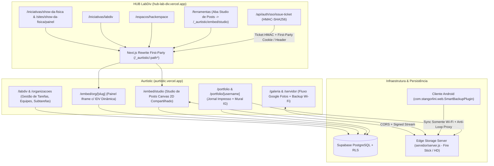

# 🏛️ Plano de Arquitetura e Implementação (v3.0 — Definitiva): Ecossistema HUB LabDiv ↔ Aurtistic

**Autor:** Arquiteto de Software Sênior (Antigravity)  
**Data:** 14 de Novembro de 2026  
**Versão:** **v3.0 (Definitiva — Blindagem Completa com 12 Correções Críticas de SQL, RLS, CSRF/Static Iframe, Canvas 2D, Proxy Anti-Loop e Segurança)**  
**Escopo:** Integração Unificada entre `Aurtistic` (`/home/stangorlini/Aurtistic`) e `HUB LabDiv` (`/home/stangorlini/HUB LabDiv` — `hub-lab-div.vercel.app`)  
**Status:** Pronto para Aprovação Final e Início da Fase 1

---

## 📋 Changelog Arquitetural (v1 → v2 → v3.0)

| # | Ponto Crítico Blindado | Resolução Definitiva na v3.0 |
| :-: | :--- | :--- |
| **1** | **Operador `??` ao Esvaziar Equipes & Herança no `INSERT` (`1.2`, `1.3`)** | `resolvedSubteams` explícito em `subtasksPayload` (impede `[][0] ?? st.subteam_id` de ressuscitar equipe antiga) e herança no trigger `INSERT` condicionada a `COALESCE(array_length(NEW.assigned_member_ids, 1), 0) = 0`. |
| **2** | **Preservação de Múltiplas Equipes no Trigger `UPDATE` (`1.2`)** | No `TG_OP = 'UPDATE'`, alteração legada de `subteam_id` usa `array_prepend(NEW.subteam_id, array_remove(COALESCE(OLD.assigned_subteam_ids, '{}'::uuid[]), NEW.subteam_id))` sem apagar demais equipes. |
| **3** | **Validação de UUID na Deleção de Subtarefas Órfãs (`1.3`)** | Geração antecipada de `crypto.randomUUID()`, validação estrita por regex UUID antes do `upsert` das subtarefas ativas e `delete()` posterior apenas das órfãs fora da lista final. |
| **4** | **Políticas RLS Explícitas para Subtarefas (`1.2`)** | Migration `09` inclui políticas RLS explícitas garantindo `SELECT`, `INSERT`, `UPDATE` e `DELETE` para membros (`public.is_org_member(organization_id)`) em tarefas e subtarefas (`parent_id IS NOT NULL`). |
| **5** | **CSRF `allowedOrigins`, `/_next/static` e `proxy.ts`/Middleware (`2.4`, `2.6`)** | `experimental.serverActions.allowedOrigins` no `next.config.ts`, suporte simultâneo a Cookies First-Party/Partitioned (`SameSite=None; Secure; Partitioned`) + `x-supabase-auth-token` sem 404 em `/_next/static`, e liberação de `/embed/:path*` e `/api/auth/hub-embed` no middleware/`proxy.ts`. |
| **6** | **Isolamento `ctx.filter = 'none'` & Lexer `*Destaques Compostos*` (`2.5`)** | `ctx.filter = 'none'` antes de renderizar textos (evita que filtros da foto escureçam o neon) e lexer que processa `*...*` e `[r:...]` antes de quebrar por espaços (suporta `*Marie Curie*` em múltiplas linhas). |
| **7** | **Exportação Assíncrona Segura de Carrossel (`2.5`)** | Renderização sequencial com `await new Promise(res => offscreenCanvas.toBlob(res, 'image/png'))` e empacotamento em `.zip` único client-side (ou Web Share API no mobile) evitando bloqueio de downloads múltiplos. |
| **8** | **Cast Determinístico `IMMUTABLE` & `captured_at` no `UPDATE` (`3.2`)** | `try_parse_exif_timestamp` usa `(v_clean::timestamp AT TIME ZONE 'America/Sao_Paulo')` (`IMMUTABLE` real) e trigger recalcula `captured_at` também em `TG_OP = 'UPDATE' AND NEW.exif_data IS DISTINCT FROM OLD.exif_data`. |
| **9** | **Assinatura Binária Trailer do Proxy & Inspeção Dual no Edge (`3.3`)** | Helper `appendProxySignatureTrailer` anexa `AURTISTIC_PROXY_OF:<sha256>:<size>` ao final do WebP/JPEG; `servidor/server.js` inspeciona os primeiros 64 KB **e** os últimos 64 KB (ou buffer inteiro se `< 2 MB`). |
| **10** | **Paginação por Cursor na Timeline (`3.1`, `3.4`)** | `getGalleryTimelinePageAction({ cursorCapturedAt, cursorId, filter, limit = 120 })` em `servidor/actions.ts` com keyset `(captured_at, id) < ($1, $2)` e projeção leve sem `exif_data` completo. |
| **11** | **Validação Android Independente da Extensão Java VS Code (`3.5`)** | Verificação de `SmartBackupPlugin.kt` e `MainActivity.java` via Gradle/compilador do projeto (ou revisão estática Capacitor 8), sem depender do Language Server Java do VS Code (JDK 25+). |
| **12** | **Validação Estrita de Hostname & `?cr=1&v=14` no Instagram (`4.4`)** | Checagem estrita via `new URL(event.origin).hostname` (`=== 'instagram.com' || endsWith('.instagram.com')`) e query `?cr=1&v=14` na URL de embed do Instagram. |

---

## Visão Geral da Arquitetura do Ecossistema



---

## FASE 1: Refatoração da Criação de Tarefas por Organização (`TaskFormModal.tsx` e `TasksView.tsx`)

### 1.1. Diagnóstico Atual
1. **Banco de Dados (`supabase/migrations/newsqls/06_multi_organizations_v4_complete.sql`, L160-L168 e L312-L340):**
   - A tabela `public.tasks` possui `organization_id UUID`, `subteam_id UUID` (apenas **1 equipe** por tarefa), `assigned_member_ids UUID[] DEFAULT '{}'::uuid[]`, `parent_id UUID` e `responsavel TEXT`.
   - O trigger `trg_inherit_task_subteam` (`L312-L340`) dispara `BEFORE INSERT ON public.tasks` e preenche `NEW.subteam_id` com a equipe do autor quando `NEW.subteam_id IS NULL`. Como o PostgreSQL executa múltiplos triggers `BEFORE` em **ordem alfabética**, manter `trg_inherit_task_subteam` conflitaria com qualquer trigger `trg_sync_*` posterior.
2. **Server Actions (`src/app/(dashboard)/actions.ts`, L32-L141 e `src/app/(dashboard)/organizacoes/actions.ts`, L35-L192):**
   - `saveTask` (`actions.ts:L106-L129`) propaga alterações da tarefa-mãe (`propagateKeys = ['dimensao', 'categoria', 'prazo', 'responsavel', 'prioridade', 'status']`) para todas as subtarefas (`WHERE parent_id = dataToSave.id`), **sobrescrevendo acidentalmente** o responsável individual de uma subtarefa quando a tarefa-mãe é editada.
   - `getOrganizationDetailsAction(orgId)` (`organizacoes/actions.ts:L136`) busca `subteams` e `members` apenas da organização ativa em `TasksView.tsx` (`L198-L211`).
3. **Interface (`src/components/dashboard/TaskFormModal.tsx` e `src/components/dashboard/TasksView.tsx`):**
   - Em `TaskFormModal.tsx` (`L478-L587`), ao trocar de organização no `<select>` (`L486`), os arrays `subteams` e `members` não são recarregados dinamicamente.
   - O seletor atual mistura "Categoria da Tarefa (Eixo Obrigatório)" (`subteam_id` único) com botões de membros (`assigned_member_ids`), não oferecendo dois seletores independentes para **Equipes** e **Indivíduos**.
   - Na seção de **Sub-tarefas** (`TaskFormModal.tsx:L209-L232` e `L935-L971`): (a) não é possível delegar cada subtarefa a uma Equipe/Indivíduo; (b) ao editar subtarefa existente (`L222-L229`), `handleSubmit` envia apenas `{ id, nome, status, parent_id }`, descartando delegações e ordem; (c) subtarefas removidas da lista local antes de salvar ou salvas em lote precisam de limpeza de órfãs e preservação de `ordem_manual`.

### 1.2. Mudanças no Banco de Dados (Supabase) — *Corrigido na v2 (Ponto 1)*
Criar a migration `supabase/migrations/newsqls/09_tasks_multi_subteams_and_subtasks_delegation.sql`:

```sql
BEGIN;

-- 1. Suporte a múltiplas Equipes responsáveis na tarefa e subtarefa
ALTER TABLE public.tasks
  ADD COLUMN IF NOT EXISTS assigned_subteam_ids UUID[] NOT NULL DEFAULT '{}'::uuid[];

-- Backfill: garante que tarefas que já tinham subteam_id tenham esse UUID em assigned_subteam_ids
UPDATE public.tasks
SET assigned_subteam_ids = ARRAY[subteam_id]
WHERE subteam_id IS NOT NULL
  AND (assigned_subteam_ids IS NULL OR COALESCE(array_length(assigned_subteam_ids, 1), 0) = 0);

-- 2. Índices GIN para filtragem rápida por Equipes e Indivíduos (e B-Tree para subtarefas ordenadas)
CREATE INDEX IF NOT EXISTS idx_tasks_assigned_subteams_gin ON public.tasks USING GIN (assigned_subteam_ids);
CREATE INDEX IF NOT EXISTS idx_tasks_assigned_members_gin ON public.tasks USING GIN (assigned_member_ids);
CREATE INDEX IF NOT EXISTS idx_tasks_parent_order ON public.tasks (parent_id, ordem_manual, created_at) WHERE parent_id IS NOT NULL;

-- 3. [CORREÇÃO CRÍTICA v2]: Remove o trigger legado trg_inherit_task_subteam para evitar conflito
-- de ordem alfabética e unifica toda a resolução de subteam_id <-> assigned_subteam_ids em uma única função
DROP TRIGGER IF EXISTS trg_inherit_task_subteam ON public.tasks;
DROP FUNCTION IF EXISTS public.inherit_task_subteam_from_member();
DROP TRIGGER IF EXISTS trg_sync_task_subteams_array ON public.tasks;
DROP FUNCTION IF EXISTS public.sync_task_subteams_array();

CREATE OR REPLACE FUNCTION public.resolve_and_sync_task_subteams()
RETURNS TRIGGER
LANGUAGE plpgsql
SECURITY DEFINER
SET search_path = public
AS $$
DECLARE
  v_member_subteam UUID;
BEGIN
  -- Garante que assigned_subteam_ids nunca seja NULL
  IF NEW.assigned_subteam_ids IS NULL THEN
    NEW.assigned_subteam_ids := '{}'::uuid[];
  END IF;

  IF TG_OP = 'INSERT' THEN
    -- Caso 1: O cliente enviou assigned_subteam_ids preenchido -> sincroniza subteam_id com o 1º item
    IF COALESCE(array_length(NEW.assigned_subteam_ids, 1), 0) > 0 THEN
      NEW.subteam_id := NEW.assigned_subteam_ids[1];

    -- Caso 2: Código legado enviou apenas subteam_id -> popula assigned_subteam_ids
    ELSIF NEW.subteam_id IS NOT NULL THEN
      NEW.assigned_subteam_ids := ARRAY[NEW.subteam_id];

    -- Caso 3: Tarefa organizacional raiz sem equipe E sem indivíduos atribuídos -> herda equipe do autor
    ELSIF NEW.organization_id IS NOT NULL
      AND NEW.parent_id IS NULL
      AND COALESCE(array_length(NEW.assigned_member_ids, 1), 0) = 0 THEN
      SELECT subteam_id INTO v_member_subteam
      FROM public.organization_members
      WHERE organization_id = NEW.organization_id
        AND user_id = auth.uid()
      LIMIT 1;

      IF v_member_subteam IS NOT NULL THEN
        NEW.subteam_id := v_member_subteam;
        NEW.assigned_subteam_ids := ARRAY[v_member_subteam];
      END IF;
    END IF;

  ELSIF TG_OP = 'UPDATE' THEN
    -- Se assigned_subteam_ids mudou (inclusive se foi limpo para '{}'), ele é a fonte da verdade absoluta!
    IF NEW.assigned_subteam_ids IS DISTINCT FROM OLD.assigned_subteam_ids THEN
      IF COALESCE(array_length(NEW.assigned_subteam_ids, 1), 0) > 0 THEN
        NEW.subteam_id := NEW.assigned_subteam_ids[1];
      ELSE
        NEW.subteam_id := NULL;
      END IF;

    -- Se apenas subteam_id foi alterado por view legada, preserva as demais equipes no array
    ELSIF NEW.subteam_id IS DISTINCT FROM OLD.subteam_id THEN
      IF NEW.subteam_id IS NOT NULL THEN
        NEW.assigned_subteam_ids := array_prepend(
          NEW.subteam_id,
          array_remove(COALESCE(OLD.assigned_subteam_ids, '{}'::uuid[]), NEW.subteam_id)
        );
      ELSE
        NEW.assigned_subteam_ids := '{}'::uuid[];
      END IF;
    END IF;
  END IF;

  RETURN NEW;
END;
$$;

CREATE TRIGGER trg_01_resolve_and_sync_task_subteams
  BEFORE INSERT OR UPDATE ON public.tasks
  FOR EACH ROW
  EXECUTE FUNCTION public.resolve_and_sync_task_subteams();

-- 4. [CORREÇÃO v3.0 - Ponto 4]: Políticas RLS explícitas para tarefas e subtarefas organizacionais
ALTER TABLE public.tasks ENABLE ROW LEVEL SECURITY;

DROP POLICY IF EXISTS "Org members can select org tasks and subtasks" ON public.tasks;
CREATE POLICY "Org members can select org tasks and subtasks"
  ON public.tasks FOR SELECT
  USING (
    organization_id IS NOT NULL
    AND public.is_org_member(organization_id)
  );

DROP POLICY IF EXISTS "Org members can insert org tasks and subtasks" ON public.tasks;
CREATE POLICY "Org members can insert org tasks and subtasks"
  ON public.tasks FOR INSERT
  WITH CHECK (
    organization_id IS NOT NULL
    AND public.is_org_member(organization_id)
  );

DROP POLICY IF EXISTS "Org members can update org tasks and subtasks" ON public.tasks;
CREATE POLICY "Org members can update org tasks and subtasks"
  ON public.tasks FOR UPDATE
  USING (
    organization_id IS NOT NULL
    AND public.is_org_member(organization_id)
  )
  WITH CHECK (
    organization_id IS NOT NULL
    AND public.is_org_member(organization_id)
  );

DROP POLICY IF EXISTS "Org members can delete org tasks and subtasks" ON public.tasks;
CREATE POLICY "Org members can delete org tasks and subtasks"
  ON public.tasks FOR DELETE
  USING (
    organization_id IS NOT NULL
    AND public.is_org_member(organization_id)
  );

COMMIT;
```

### 1.3. Especificação do Salvamento Atômico Pai + Subtarefas (`saveTaskWithSubtasksAction`) — *Blindado na v3.0 (Pontos 1 e 3)*
Em `src/app/(dashboard)/actions.ts`, além de manter `saveTask` para edições unitárias, criaremos `saveTaskWithSubtasksAction(parentTask: Partial<Task>, subtasks: Partial<Task>[])`:
1. **Normalização da Tarefa-Mãe:**
   - Resolve `const parentSubteams = Array.isArray(parentTask.assigned_subteam_ids) ? parentTask.assigned_subteam_ids : (parentTask.subteam_id ? [parentTask.subteam_id] : []);`
   - Define `subteam_id: parentSubteams[0] ?? null` e `assigned_subteam_ids: parentSubteams`.
   - Sincroniza `assigned_member_ids` e `responsavel` legado e executa `upsert` da tarefa-mãe em `public.tasks`.
2. **Geração/Validação Prévia de UUIDs, Upsert Ativo e Deleção Segura de Órfãs:**
   - Validador estrito: `const UUID_REGEX = /^[0-9a-f]{8}-[0-9a-f]{4}-[0-9a-f]{4}-[0-9a-f]{4}-[0-9a-f]{12}$/i;`
   - Gera UUIDs definitivos **antes** do `upsert`, evitando que IDs temporários de frontend quebrem o `.not('id', 'in', ...)`:
     ```ts
     const subtasksPayload = subtasks.map((st, idx) => {
       const safeId = st.id && UUID_REGEX.test(st.id) ? st.id : crypto.randomUUID();
       const resolvedSubteams = Array.isArray(st.assigned_subteam_ids)
         ? st.assigned_subteam_ids
         : (st.subteam_id ? [st.subteam_id] : []);

       return {
         id: safeId,
         parent_id: parentTaskId,
         user_id: parentTask.user_id || actionUser.id,
         organization_id: parentTask.organization_id || null,
         is_personal: parentTask.is_personal ?? false,
         nome: (st.nome || '').trim(),
         status: st.status || 'não iniciada',
         ordem_manual: idx,
         subteam_id: resolvedSubteams[0] ?? null,
         assigned_subteam_ids: resolvedSubteams,
         assigned_member_ids: Array.isArray(st.assigned_member_ids) ? st.assigned_member_ids : [],
         responsavel: st.responsavel ?? null,
         prazo: st.prazo || parentTask.prazo || null,
         prioridade: st.prioridade || parentTask.prioridade || 'Baixa',
         dimensao: parentTask.dimensao || 'HUB',
         categoria: parentTask.categoria || null,
       };
     });

     const validKeptIds = subtasksPayload
       .map((item) => item.id)
       .filter((id) => UUID_REGEX.test(id));

     if (subtasksPayload.length > 0) {
       const { error: upsertSubError } = await supabase
         .from('tasks')
         .upsert(subtasksPayload, { onConflict: 'id' });
       if (upsertSubError) throw upsertSubError;
     }

     if (validKeptIds.length > 0) {
       await supabase
         .from('tasks')
         .delete()
         .eq('parent_id', parentTaskId)
         .not('id', 'in', `(${validKeptIds.join(',')})`);
     } else {
       await supabase
         .from('tasks')
         .delete()
         .eq('parent_id', parentTaskId);
     }
     ```
3. **Proteção na Propagação Pai → Filhas (`saveTask` unitário):**
   - Quando `saveTask` atualizar uma tarefa-mãe existente fora do modal (ex: inline edit na tabela), **nunca** incluirá `responsavel`, `subteam_id`, `assigned_subteam_ids` ou `assigned_member_ids` no `update().eq('parent_id', id)` das subtarefas que já possuam delegação própria.

### 1.4. Arquivos que serão Criados ou Modificados (Fase 1)
| Arquivo | Ação | Responsabilidade |
| :--- | :---: | :--- |
| `supabase/migrations/newsqls/09_tasks_multi_subteams_and_subtasks_delegation.sql` | `[NEW]` | Migration SQL adicionando `assigned_subteam_ids UUID[]`, índices GIN/B-Tree e o trigger unificado `trg_01_resolve_and_sync_task_subteams`. |
| `src/types/index.ts` | `[MODIFY]` | Adicionar `assigned_subteam_ids?: string[]` na interface `Task` (`L19-L45`). |
| `src/app/(dashboard)/actions.ts` | `[MODIFY]` | Refatorar `saveTask` (`L32-L141`) para preservar delegações de subtarefas e criar `saveTaskWithSubtasksAction` (com deleção de subtarefas órfãs, `ordem_manual = idx` e batch upsert). |
| `src/lib/offlineActions.ts` | `[MODIFY]` | Expor `saveTaskWithSubtasks` com fallback offline consistente com `saveTask`. |
| `src/app/(dashboard)/organizacoes/actions.ts` | `[MODIFY]` | Garantir que `getOrganizationDetailsAction(orgId)` retorne `subteams` e `members` rapidamente ao trocar de organização no modal. |
| `src/components/dashboard/TaskFormModal.tsx` | `[MODIFY]` | (1) `useEffect` que recarrega `subteams` e `members` via `getOrganizationDetailsAction` sempre que `formData.organization_id` mudar; (2) dois seletores independentes (**Seletor de Equipes** `assigned_subteam_ids` e **Seletor de Indivíduos** `assigned_member_ids`); (3) seção **Sub-tarefas ("Definir o que será feito")** com delegação por subtarefa (Equipe e/ou Indivíduo), reordenação/remoção limpa e chamada a `saveTaskWithSubtasks`. |
| `src/components/dashboard/TasksView.tsx` | `[MODIFY]` | Ordenar subtarefas por `ordem_manual`, exibir badges de Equipes e Indivíduos tanto na tarefa-mãe quanto em cada linha do checklist de subtarefas (`L2440-L2580`), com contador `X/Y` e toggle rápido. |
| `src/components/organizacoes/TeamProgressPanel.tsx` | `[MODIFY]` | Contabilizar tarefas atribuídas via `assigned_subteam_ids` (além de `subteam_id`) no painel de progresso das equipes. |

### 1.5. Ordem de Execução Recomendada (Fase 1)
1. Aplicar `09_tasks_multi_subteams_and_subtasks_delegation.sql` e atualizar `src/types/index.ts`.
2. Implementar `saveTaskWithSubtasksAction` em `src/app/(dashboard)/actions.ts` e `src/lib/offlineActions.ts`.
3. Refatorar `TaskFormModal.tsx` (carregamento dinâmico por organização, seletores independentes de Equipes e Indivíduos, e subtarefas com delegação).
4. Atualizar `TasksView.tsx` e `TeamProgressPanel.tsx` e validar com `npm run verify:silent`.

---

## FASE 2: Identidade Visual (IDV) Dinâmica + Integração via Iframe no HUB + Studio de Posts Automáticos

### 2.1. Diagnóstico Atual
1. **Tabela `public.organizations` (`supabase/migrations/newsqls/06_multi_organizations_v4_complete.sql`):**
   - Na definição DDL (`L11-L26`), as colunas `NOT NULL` são: `id`, `slug`, `name`, `storage_quota_bytes` (`DEFAULT 53687091200`), `storage_used_bytes` (`DEFAULT 0`), `storage_policy` (`DEFAULT 'admin_or_permitted'`), `created_at` e `updated_at`.
   - Na função `public.create_new_organization` (`L793-L806`) e em `src/app/(dashboard)/labdiv/page.tsx` (`L38-L40`), há referências legadas a `created_by` e `vault_quota_bytes`.
2. **SSO e Iframe HUB ↔ Aurtistic:**
   - No Next.js App Router, Server Components e Server Actions (`saveTask`, `getOrganizationDetailsAction`) leem a sessão via `cookies()` no servidor (`@supabase/ssr` em `src/utils/supabase/server.ts`). Se o iframe do Aurtistic for carregado cross-domain (`aurtistic.vercel.app` dentro de `hub-lab-div.vercel.app`) em navegadores com bloqueio estrito de cookies de terceiros (Safari ITP, Brave, Firefox ETP), `cookies()` no servidor chega vazio e as Server Actions falham.
3. **Canvas 2D e Studio de Posts:**
   - `ctx.fillText()` nativo do HTML5 Canvas 2D só aceita um único `fillStyle` e `shadowColor` por chamada, exigindo um motor de layout de texto tokenizado para suportar múltiplas cores na mesma linha (ex: **SHOW** em vermelho, **DE** em azul, **FÍSICA** em verde) ou palavras destacadas entre `*asteriscos*`.
   - O servidor de mídia Edge (`servidor/server.js`) precisa responder com headers CORS explícitos nas rotas de stream/thumb para que o Canvas 2D possa exportar imagens (`toBlob()`) sem erro de *Tainted Canvas*.

### 2.2. Especificação do Motor de IDV Compartilhado (`src/lib/org-brand-tokens.ts`)
| Token / Propriedade | `show-da-fisica` (Show da Física) | `labdiv` (LabDiv IFUSP) | `hs` / `hackerspace` (Hackerspace) |
| :--- | :--- | :--- | :--- |
| **Background Principal (`bgApp`)** | `#07090e` (Preto Profundo Sci-Fi) | `#0b0f19` (Azul Noturno Editorial) | `#080808` (Terminal Black) |
| **Background Surface (`bgSurface`)** | `#0d111a` | `#111827` | `#101412` |
| **Texto Principal (`textPrimary`)** | `#e2e8f0` (Slate 200 limpo) | `#f8fafc` | `#e2f1e8` |
| **Cores Neon / Accent** | Vermelho `#ff1e1e`, Azul `#0066ff`, Verde `#00ff44`, Amarelo `#ffcc00` | Azul `#049fff`, Roxo `#9d4edd`, Amarelo `#ffcc00`, Vermelho `#ef4444` | Verde Matrix `#00ff66`, Amarelo `#ffcc00`, Ciano `#06b6d4` |
| **Fonte de Título (`fontDisplay`)** | `'Orbitron', sans-serif` (Caixa Alta `uppercase`, `letter-spacing: 0.08em`) | `'Space Grotesk', 'Inter', sans-serif` (Bold/Black) | `'JetBrains Mono', monospace` (Caixa Alta `[SYSTEM]`) |
| **Fonte de Texto (`fontBody`)** | `'Inter', 'Plus Jakarta Sans', sans-serif` (`#e2e8f0`) | `'Inter', sans-serif` | `'Open Sans', 'Inter', sans-serif` |
| **Efeito Título (`titleShadow` / Canvas Glow)** | Outer Glow Neon: `0 0 6px <neon>, 0 0 14px <neon>, 0 0 28px <neon>` (`ctx.shadowBlur = 24`) | Drop Shadow Editorial: `0 4px 20px rgba(4,159,255,0.35)` | Terminal Glow: `0 0 10px rgba(0,255,102,0.6)` |
| **Estilo de Borda (`borderStyle`)** | `2px solid <neon>` + `box-shadow: 0 0 12px <neon>, inset 0 0 8px <neon>` | `1px solid rgba(4,159,255,0.3)` (`border-radius: 16px`) | `1px solid rgba(0,255,102,0.35)` (`border-radius: 12px`) |

### 2.3. Mudanças no Banco de Dados (Supabase) — *Corrigido na v2 (Ponto 6)*
Criar a migration `supabase/migrations/newsqls/10_org_idv_and_post_studio_presets.sql`:

```sql
BEGIN;

-- 1. Adiciona brand_config JSONB e normaliza colunas potencialmente divergentes em public.organizations
ALTER TABLE public.organizations
  ADD COLUMN IF NOT EXISTS brand_config JSONB NOT NULL DEFAULT '{}'::jsonb,
  ADD COLUMN IF NOT EXISTS created_by UUID REFERENCES auth.users(id) ON DELETE SET NULL;

-- Bloco defensivo: caso o banco tenha sido criado por script legado com owner_id ou vault_quota_bytes NOT NULL
DO $$
BEGIN
  IF EXISTS (
    SELECT 1 FROM information_schema.columns
    WHERE table_schema = 'public' AND table_name = 'organizations' AND column_name = 'owner_id'
  ) THEN
    EXECUTE 'ALTER TABLE public.organizations ALTER COLUMN owner_id DROP NOT NULL';
  END IF;

  IF EXISTS (
    SELECT 1 FROM information_schema.columns
    WHERE table_schema = 'public' AND table_name = 'organizations' AND column_name = 'vault_quota_bytes'
  ) THEN
    EXECUTE 'ALTER TABLE public.organizations ALTER COLUMN vault_quota_bytes SET DEFAULT 53687091200';
    EXECUTE 'ALTER TABLE public.organizations ALTER COLUMN vault_quota_bytes DROP NOT NULL';
  END IF;
END $$;

-- 2. Corrige a RPC create_new_organization (que na migration 06 L798 referenciava vault_quota_bytes inexistente)
CREATE OR REPLACE FUNCTION public.create_new_organization(
  p_name TEXT,
  p_slug TEXT DEFAULT NULL,
  p_description TEXT DEFAULT NULL
)
RETURNS JSONB
LANGUAGE plpgsql
SECURITY DEFINER
SET search_path = public
AS $$
DECLARE
  v_user_id UUID := auth.uid();
  v_clean_name TEXT := trim(COALESCE(p_name, ''));
  v_clean_slug TEXT := lower(trim(COALESCE(p_slug, '')));
  v_org public.organizations%ROWTYPE;
  v_user_name TEXT;
  v_user_email TEXT;
BEGIN
  IF v_user_id IS NULL THEN
    RAISE EXCEPTION 'Autenticação necessária para criar organização.';
  END IF;
  IF v_clean_name = '' THEN
    RAISE EXCEPTION 'Nome da organização é obrigatório.';
  END IF;
  IF v_clean_slug = '' THEN
    v_clean_slug := lower(regexp_replace(v_clean_name, '[^a-zA-Z0-9]+', '-', 'g'));
  END IF;
  v_clean_slug := trim(both '-' from v_clean_slug);

  INSERT INTO public.organizations (
    name, slug, description, created_by, storage_quota_bytes, storage_used_bytes, storage_policy
  ) VALUES (
    v_clean_name, v_clean_slug, p_description, v_user_id, 53687091200, 0, 'admin_or_permitted'
  )
  RETURNING * INTO v_org;

  SELECT COALESCE(raw_user_meta_data->>'full_name', email), email
  INTO v_user_name, v_user_email
  FROM auth.users WHERE id = v_user_id;

  INSERT INTO public.organization_members (
    organization_id, user_id, full_name, email, org_role, can_upload_org_vault, cognitive_capacity
  ) VALUES (
    v_org.id, v_user_id, COALESCE(v_user_name, 'Admin'), v_user_email, 'admin', true, 'normal'
  );

  INSERT INTO public.organization_subteams (organization_id, name, color)
  VALUES
    (v_org.id, 'Coordenação', '#9D4EDD'),
    (v_org.id, 'Comunicação', '#06B6D4'),
    (v_org.id, 'Pesquisa', '#10B981')
  ON CONFLICT (organization_id, name) DO NOTHING;

  RETURN to_jsonb(v_org);
END;
$$;

-- 3. Seed completo das 3 Organizações Institucionais respeitando 100% das constraints NOT NULL
INSERT INTO public.organizations (
  id, slug, name, description, primary_color, secondary_color,
  storage_quota_bytes, storage_used_bytes, storage_policy, brand_config
)
VALUES
  (
    '1ab41410-0000-4000-8000-000000000001',
    'labdiv',
    'LabDiv',
    'Laboratório de Comunicação e Divulgação Científica do IFUSP',
    '#049FFF',
    '#FFCC00',
    53687091200,
    0,
    'admin_or_permitted',
    '{"themeId":"labdiv","bgApp":"#0b0f19","bgSurface":"#111827","textPrimary":"#f8fafc","accents":["#049fff","#ffcc00","#ef4444","#9d4edd"],"fontDisplay":"Space Grotesk","fontBody":"Inter","uppercaseTitles":false,"glowIntensity":0.4}'::jsonb
  ),
  (
    '1ab41410-0000-4000-8000-000000000002',
    'show-da-fisica',
    'Show da Física',
    'Demonstrações teatrais e lúdicas de fenômenos físicos — IFUSP',
    '#0066ff',
    '#ff1e1e',
    53687091200,
    0,
    'admin_or_permitted',
    '{"themeId":"show-da-fisica","bgApp":"#07090e","bgSurface":"#0d111a","textPrimary":"#e2e8f0","accents":["#ff1e1e","#0066ff","#00ff44","#ffcc00"],"fontDisplay":"Orbitron","fontBody":"Inter","uppercaseTitles":true,"glowIntensity":1.0}'::jsonb
  ),
  (
    '1ab41410-0000-4000-8000-000000000003',
    'hs',
    'Hackerspace IFUSP',
    'Laboratório comunitário de cultura maker, eletrônica e hardware livre',
    '#00FF66',
    '#FFCC00',
    53687091200,
    0,
    'admin_or_permitted',
    '{"themeId":"hs","bgApp":"#080808","bgSurface":"#101412","textPrimary":"#e2f1e8","accents":["#00ff66","#ffcc00","#06b6d4"],"fontDisplay":"JetBrains Mono","fontBody":"Open Sans","uppercaseTitles":true,"glowIntensity":0.75}'::jsonb
  )
ON CONFLICT (slug) DO UPDATE SET
  name = EXCLUDED.name,
  description = EXCLUDED.description,
  primary_color = EXCLUDED.primary_color,
  secondary_color = EXCLUDED.secondary_color,
  brand_config = EXCLUDED.brand_config,
  updated_at = timezone('utc'::text, now());

-- Subequipes padrão para Show da Física e Hackerspace
INSERT INTO public.organization_subteams (organization_id, name, description, color)
VALUES
  ('1ab41410-0000-4000-8000-000000000002', 'Apresentações & Palco', 'Monitores de palco e roteiros de sessões', '#ff1e1e'),
  ('1ab41410-0000-4000-8000-000000000002', 'Manutenção & Bancada', 'Oficina, reparo e montagem de experimentos', '#0066ff'),
  ('1ab41410-0000-4000-8000-000000000002', 'Comunicação & Redes', 'Divulgação, fotografia e posts científicos', '#00ff44'),
  ('1ab41410-0000-4000-8000-000000000003', 'Hardware & Eletrônica', 'Bancadas de solda, sensores e IoT', '#00ff66'),
  ('1ab41410-0000-4000-8000-000000000003', 'Fabricação Digital & 3D', 'Impressoras 3D, CNC e corte a laser', '#ffcc00'),
  ('1ab41410-0000-4000-8000-000000000003', 'Comunidade & Oficinas', 'Cursos, eventos e comunicação do HS', '#06b6d4')
ON CONFLICT (organization_id, name) DO NOTHING;

COMMIT;
```

### 2.4. Arquitetura de Integração HUB ↔ Aurtistic (CSRF `allowedOrigins`, Assets `/_next/static` & Auth Híbrida) — *Blindado na v3.0 (Ponto 5)*
Para garantir que **todos os Server Components, Server Actions (`saveTask`, `getOrganizationDetailsAction`, etc.) e chunks `/_next/static` funcionem dentro do `<iframe>` em 100% dos navegadores**, implementaremos uma arquitetura blindada contra CSRF, 404 de assets e bloqueio de 3P cookies:

1. **CSRF `allowedOrigins` no `next.config.ts` do Aurtistic:**
   - Em `Aurtistic/next.config.ts`, configuramos explicitamente:
     ```ts
     experimental: {
       serverActions: {
         allowedOrigins: [
           'hub-lab-div.vercel.app',
           '*.hublabdiv.com.br',
           'aurtistic.vercel.app',
           'localhost:3000',
           'localhost:3001',
         ],
       },
     }
     ```
   - Isso impede que o Next.js rejeite Server Actions disparadas a partir do iframe embutido no domínio do HUB (`Origin` vs `x-forwarded-host`).
2. **Roteamento `/embed/*` sem 404 em `/_next/static` + Suporte Simultâneo de Sessão:**
   - O `<iframe />` carrega diretamente `/embed/org/[slug]` e `/embed/studio` (ou via rewrite transparente quando ambos os assets `/_aurtistic/_next/static/*` e `/_aurtistic/embed/*` apontam para o mesmo origin).
   - Para eliminar qualquer risco de `404` em `/_next/static` e funcionar com ou sem proxy:
     - O endpoint `POST /api/auth/hub-embed` grava os cookies de sessão com flags `SameSite=None; Secure; Partitioned` (CHIPS — First-Party/Partitioned Cookies suportados mesmo com 3PCD ativo) **e** retorna `{ access_token, refresh_token }`.
     - Simultaneamente, o cliente no iframe envia o header `x-supabase-auth-token` (lido em `src/utils/supabase/server.ts` quando `cookieStore` estiver vazio), garantindo autenticação 100% funcional em Server Components, Server Actions e carregamento íntegro dos chunks `/_next/static/*`.
3. **Liberação de Rotas no `proxy.ts` / Middleware do Aurtistic:**
   - O arquivo de middleware/proxy do Aurtistic (`src/proxy.ts` ou `src/middleware.ts`) deve liberar `/embed/:path*` e `/api/auth/hub-embed` do redirect automático para `/login`, permitindo que a própria rota `/embed/*` valide o ticket HMAC antes de renderizar o painel autenticado.

### 2.5. Especificação do Studio de Posts Fácil, Canvas 2D Tokenizado e Exportação de Carrossel — *Blindado na v3.0 (Pontos 6 e 7)*
1. **Arquitetura de Compartilhamento entre Repositórios (Zero Duplicação):**
   - O componente `<OrganizationPostStudio />` reside **unicamente no Aurtistic** (`src/components/organizacoes/studio/OrganizationPostStudio.tsx`) e é exposto na rota dedicada `src/app/embed/studio/page.tsx` (`/embed/studio?org=show-da-fisica|labdiv|hs`), consumida em `HUB LabDiv` (`/ferramentas`) via `<AurtisticOrgEmbedFrame mode="studio" />`.
   - `getStudioGalleryMediaAction({ organizationId })` assina as fotos do Cofre da Organização, fotos pessoais e portfólio com `signEdgeTenantTicket` (`allowDownload: true`) para carregamento CORS-safe (`img.crossOrigin = 'anonymous'`).
2. **Isolamento de `ctx.filter = 'none'` e Lexer de `*Destaques Compostos*` (`src/lib/canvas-tokenized-text.ts` — Ponto 6):**
   - **Isolamento do Filtro de Imagem:** Antes de desenhar qualquer texto no Canvas 2D, dentro do bloco `ctx.save()`, definimos explicitamente **`ctx.filter = 'none';`**, garantindo que ajustes de Exposição, Contraste ou Saturação aplicados na foto de fundo nunca escureçam ou distorçam o *Outer Glow* neon da IDV.
   - **Lexer Pré-Quebra de Linha (`parseStyledTextLines`):** Os marcadores inline (`*...*` e `[r:...]`, `[b:...]`, `[g:...]`, `[y:...]`) são processados **antes** da tokenização por espaços, propagando o estilo herdado para cada palavra individualmente. Assim, termos compostos como `*Marie Curie*` ou `*dois Prêmios Nobel*` mantêm o destaque mesmo quando há quebra de linha automática em `maxBoxWidth`:
     ```ts
     // Exemplo: "*dois Prêmios Nobel*" -> [ { text: "dois", accent: true }, { text: "Prêmios", accent: true }, { text: "Nobel", accent: true } ]
     ```
   - **Desenho Posicional (`cursorX`) em 2 Passagens:** Calcula `token.width = ctx.measureText(token.text).width` e desenha palavra a palavra na coordenada `cursorX` exata (halo neon externo no 1º passe + núcleo nítido no 2º passe).
3. **Exportação Assíncrona Segura de Carrossel (Sem Bloqueio de Múltiplos Downloads — Ponto 7):**
   - Ao exportar múltiplos slides de um Carrossel, **não** disparamos múltiplos `a.click()` síncronos (que são bloqueados por Chrome/Safari e causam race condition no mesmo canvas):
     - Cada slide é renderizado **sequencialmente** em um `offscreenCanvas` dedicado aguardando:
       ```ts
       const blob = await new Promise<Blob | null>((resolve) =>
         offscreenCanvas.toBlob(resolve, 'image/png')
       );
       ```
     - Para 1 slide: download direto do `.png` (ou Web Share API no mobile).
     - Para 2+ slides (Carrossel): todos os `Blob`s sequenciais (`slide-01.png`, `slide-02.png`, ...) são empacotados em **um único arquivo `.zip`** no client-side (ou compartilhados em lote via `navigator.share({ files })` no mobile).

### 2.6. Arquivos que serão Criados ou Modificados (Fase 2) — *Blindado na v3.0 (Ponto 5)*
| Repositório / Arquivo | Ação | Responsabilidade |
| :--- | :---: | :--- |
| `Aurtistic`: `supabase/migrations/newsqls/10_org_idv_and_post_studio_presets.sql` | `[NEW]` | Normaliza `public.organizations`, corrige `create_new_organization` e faz seed seguro de `labdiv`, `show-da-fisica` e `hs`. |
| `Aurtistic`: `src/lib/org-brand-tokens.ts` | `[NEW]` | Tokens de IDV (`show-da-fisica`, `labdiv`, `hs`), variáveis CSS e configurações de tipografia/glow para UI e Canvas. |
| `Aurtistic`: `src/lib/canvas-tokenized-text.ts` | `[NEW]` | Motor de layout e renderização de texto tokenizado com `ctx.filter = 'none'` e lexer de `*destaques compostos*` + `[r:...]` antes da quebra por espaços. |
| `Aurtistic`: `src/components/organizacoes/OrganizationBrandProvider.tsx` | `[NEW]` | Injeta fontes (`Orbitron`, `JetBrains Mono`, `Inter`) e aplica a IDV dinâmica quando o usuário abre uma organização. |
| `Aurtistic`: `src/components/organizacoes/LabDivWorkspaceClient.tsx` | `[MODIFY]` | Aplica `<OrganizationBrandProvider>` e adiciona aba para abrir o `<OrganizationPostStudio />`. |
| `Aurtistic`: `src/components/organizacoes/studio/OrganizationPostStudio.tsx` | `[NEW]` | Studio de Posts em Canvas 2D (1:1, 4:5, 9:16, sliders de Exposição/Contraste/Saturação/Vibração/Overlay, Modo Post Automático IDV e Carrossel com exportação sequencial `.zip`). |
| `Aurtistic`: `src/app/embed/org/[slug]/page.tsx` | `[NEW]` | Rota dedicada sem Navbar/Footer globais para embutir a gestão da organização via `<iframe>` no HUB. |
| `Aurtistic`: `src/app/embed/studio/page.tsx` | `[NEW]` | Rota dedicada para embutir o `<OrganizationPostStudio />` na página `/ferramentas` do HUB sem duplicar código. |
| `Aurtistic`: `src/app/api/auth/hub-embed/route.ts` | `[NEW]` | Valida o ticket HMAC do HUB, autentica/provisiona o membro na organização e emite cookies `SameSite=None; Secure; Partitioned` + `{ access_token, refresh_token }`. |
| `Aurtistic`: `src/proxy.ts` (ou `src/middleware.ts`) | `[MODIFY]` | Libera `/embed/:path*` e `/api/auth/hub-embed` do redirect automático para `/login`, permitindo validação do ticket HMAC na própria rota embed. |
| `Aurtistic`: `src/utils/supabase/server.ts` | `[MODIFY]` | Adiciona fallback de leitura do header `x-supabase-auth-token` / `Authorization` quando cookies não estiverem presentes em contexto cross-origin. |
| `Aurtistic`: `next.config.ts` | `[MODIFY]` | Adiciona `experimental.serverActions.allowedOrigins`, `Content-Security-Policy: frame-ancestors` para `/embed/:path*` e headers CORS para `/api/auth/hub-embed`. |
| `Aurtistic`: `servidor/server.js` | `[MODIFY]` | Adiciona headers CORS (`Access-Control-Allow-Origin`, `Cross-Origin-Resource-Policy: cross-origin`) nas rotas `/api/tenant/stream` (`L7230`), `/api/tenant/thumb` (`L7255`) e `/portfolio-media/*` (`L2804`, `L3017`) para evitar *Tainted Canvas*. |
| `HUB LabDiv`: `next.config.ts` | `[MODIFY]` | Configura rewrite `/_aurtistic/:path*` (incluindo `/_aurtistic/_next/static/*`) quando em modo proxy first-party. |
| `HUB LabDiv`: `src/components/aurtistic/AurtisticOrgEmbedFrame.tsx` | `[NEW]` | Componente no HUB que emite ticket via `/api/auth/sso/issue-ticket` e monta o `<iframe>` para `/embed/org/[slug]` ou `/embed/studio`. |
| `HUB LabDiv`: `src/app/sites/show-da-fisica/painel/page.tsx` | `[MODIFY]` | Adiciona o módulo `[07] Tarefas & Gestão (Aurtistic)` com `<AurtisticOrgEmbedFrame orgSlug="show-da-fisica" />`. |
| `HUB LabDiv`: `src/app/iniciativas/labdiv/LabdivClient.tsx` & `src/app/espacos/hackerspace/page.tsx` | `[MODIFY]` | Adiciona seção de Gestão de Tarefas e Posts embutida para membros (`orgSlug="labdiv"` e `orgSlug="hs"`). |
| `HUB LabDiv`: `src/app/ferramentas/FerramentasClient.tsx` | `[MODIFY]` | Adiciona aba **"Studio de Posts Automáticos (IDV)"** carregando `<AurtisticOrgEmbedFrame mode="studio" />`. |

---

## FASE 3: Modo Galeria (Estilo Google Fotos) + Backup Inteligente via Wi-Fi e Gestão de Espaço

### 3.1. Diagnóstico Atual
1. **Rota `/galeria` (`src/app/galeria/page.tsx`) e `/servidor` (`src/components/servidor/UserVaultWorkspace.tsx`):**
   - `/galeria` redireciona para `/portfolio`; `/servidor` exibe apenas navegação por pastas (`grid`, `list`, `ide`).
2. **Metadados de Data (`src/components/portfolio/AurtisticGalleryGrid.tsx:L127-L134`):**
   - As fotos já indexadas em `user_files_index` guardam a data de captura dentro do JSON `exif_data` (`exif_data->>'dateTimeOriginal'` ou `exif_data->>'dateTaken'`), frequentemente no formato EXIF clássico `'YYYY:MM:DD HH:MM:SS'`. Para uma timeline estilo Google Fotos indexada no PostgreSQL, precisamos de uma coluna `captured_at TIMESTAMPTZ` com **backfill automático** desses metadados existentes.
3. **Pacote Android (`android/app/build.gradle` e `MainActivity.java`):**
   - O namespace Kotlin/Java em `android/app/build.gradle` (`L4`) e `MainActivity.java` (`L1`) é `com.stangorlini.web` (enquanto `applicationId` é `com.stangorlini.aurtistic`). Plugins locais são registrados em `MainActivity.onCreate` via `registerPlugin(...)`.

### 3.2. Mudanças no Banco de Dados (Supabase) com Backfill EXIF e Anti-Loop — *Corrigido na v2 (Pontos 7 e 8B)*
Criar a migration `supabase/migrations/newsqls/11_gallery_timeline_and_smart_backup.sql`:

```sql
BEGIN;

-- 1. Novas colunas para Timeline Google Fotos, Deduplicação SHA-256 e Proteção contra Loop de Proxy Comprimido
ALTER TABLE public.user_files_index
  ADD COLUMN IF NOT EXISTS captured_at TIMESTAMPTZ,
  ADD COLUMN IF NOT EXISTS content_hash TEXT,
  ADD COLUMN IF NOT EXISTS original_size_bytes BIGINT,
  ADD COLUMN IF NOT EXISTS compressed_proxy_hash TEXT,
  ADD COLUMN IF NOT EXISTS is_local_compressed_proxy BOOLEAN NOT NULL DEFAULT false,
  ADD COLUMN IF NOT EXISTS device_source TEXT;

-- 2. [CORREÇÃO v3.0 - Ponto 8]: Função auxiliar determinística (IMMUTABLE) usando timezone explícito America/Sao_Paulo
CREATE OR REPLACE FUNCTION public.try_parse_exif_timestamp(p_raw TEXT)
RETURNS TIMESTAMPTZ
LANGUAGE plpgsql
IMMUTABLE
AS $$
DECLARE
  v_clean TEXT;
BEGIN
  IF p_raw IS NULL OR trim(p_raw) = '' OR trim(p_raw) = 'null' THEN
    RETURN NULL;
  END IF;
  -- Converte '2026:05:14 18:30:00' -> '2026-05-14 18:30:00' e remove sufixo de offset se houver
  v_clean := regexp_replace(trim(p_raw), '^(\d{4}):(\d{2}):(\d{2})', '\1-\2-\3');
  v_clean := regexp_replace(v_clean, '(Z|[+-]\d{2}:?\d{2})$', '');
  RETURN (v_clean::timestamp AT TIME ZONE 'America/Sao_Paulo');
EXCEPTION WHEN OTHERS THEN
  RETURN NULL;
END;
$$;

-- 3. Backfill imediato de captured_at e original_size_bytes para todas as fotos existentes
UPDATE public.user_files_index
SET
  captured_at = COALESCE(
    public.try_parse_exif_timestamp(
      COALESCE(
        exif_data->>'dateTimeOriginal',
        exif_data->>'dateTaken',
        exif_data->>'DateTimeOriginal',
        exif_data->>'CreateDate'
      )
    ),
    created_at
  ),
  original_size_bytes = COALESCE(original_size_bytes, size_bytes)
WHERE captured_at IS NULL;

-- 4. [CORREÇÃO v3.0 - Ponto 8]: Recalcula captured_at também quando exif_data mudar no UPDATE
CREATE OR REPLACE FUNCTION public.sync_user_files_captured_at()
RETURNS TRIGGER
LANGUAGE plpgsql
SECURITY DEFINER
SET search_path = public
AS $$
BEGIN
  IF NEW.captured_at IS NULL
     OR (TG_OP = 'UPDATE' AND NEW.exif_data IS DISTINCT FROM OLD.exif_data) THEN
    NEW.captured_at := COALESCE(
      public.try_parse_exif_timestamp(
        COALESCE(
          NEW.exif_data->>'dateTimeOriginal',
          NEW.exif_data->>'dateTaken',
          NEW.exif_data->>'DateTimeOriginal',
          NEW.exif_data->>'CreateDate'
        )
      ),
      NEW.captured_at,
      NEW.created_at,
      timezone('utc'::text, now())
    );
  END IF;

  IF NEW.original_size_bytes IS NULL AND NEW.size_bytes > 0 THEN
    NEW.original_size_bytes := NEW.size_bytes;
  END IF;

  RETURN NEW;
END;
$$;

DROP TRIGGER IF EXISTS trg_sync_user_files_captured_at ON public.user_files_index;
CREATE TRIGGER trg_sync_user_files_captured_at
  BEFORE INSERT OR UPDATE ON public.user_files_index
  FOR EACH ROW
  EXECUTE FUNCTION public.sync_user_files_captured_at();

-- 5. Índices para Paginação por Cursor (Keyset) na Timeline e Verificação O(1) de Hashes
CREATE INDEX IF NOT EXISTS idx_user_files_timeline_keyset
  ON public.user_files_index (user_id, is_directory, captured_at DESC, id DESC)
  WHERE is_directory = false;

CREATE INDEX IF NOT EXISTS idx_user_files_content_hash
  ON public.user_files_index (user_id, content_hash)
  WHERE content_hash IS NOT NULL;

CREATE INDEX IF NOT EXISTS idx_user_files_compressed_proxy_hash
  ON public.user_files_index (user_id, compressed_proxy_hash)
  WHERE compressed_proxy_hash IS NOT NULL;

COMMIT;
```

### 3.3. Blindagem Anti-Loop na Política `replace_compressed` e Trava Wi-Fi — *Blindado na v3.0 (Ponto 9)*
Quando o usuário escolhe a **Opção C (`replace_compressed` — manter qualidade 100% original no servidor Edge e substituir o arquivo no celular por uma versão comprimida leve)**, o arquivo local passa a ter um tamanho menor (~`180 KB`) e um hash diferente (`BBB` != `AAA`). Para **impedir em 100% dos casos** que um ciclo futuro de backup re-envie o arquivo comprimido de `180 KB` sobrescrevendo o original de `12 MB` no servidor:

1. **Camada 1 — Assinatura Binária Trailer (Web + Android) e EXIF (Android):**
   - Como `canvas.toBlob('image/webp')` na Web remove metadados EXIF e arquivos WebP/JPEG podem posicionar chunks no final do arquivo, criaremos `src/lib/proxy-signature.ts` (`appendProxySignatureTrailer`) que anexa o trailer binário `AURTISTIC_PROXY_OF:<original_sha256>:<original_size_bytes>` ao final do arquivo comprimido gerado na Web (além da tag EXIF `UserComment` gravada pelo `SmartBackupPlugin.kt` no Android e do header HTTP `x-aurtistic-proxy: 1`).
2. **Camada 2 — Reconhecimento Duplo de Hash no Sincronizador:**
   - O sincronizador local ignora imediatamente qualquer arquivo que contenha `AURTISTIC_PROXY_OF:` (no EXIF ou no trailer final) ou cujo hash local coincida com `content_hash` **ou** `compressed_proxy_hash` em `user_files_index`.
3. **Camada 3 — Inspeção Dual (Primeiros 64 KB + Últimos 64 KB) em `servidor/server.js`:**
   - Em `POST /api/tenant/upload` (`servidor/server.js:L7463-L7509`):
     - Inspeciona os **primeiros 64 KB e os últimos 64 KB** do arquivo recebido em `stagedPath` (ou o buffer completo se o arquivo tiver `< 2 MB`) procurando a assinatura `AURTISTIC_PROXY_OF:`, além de checar `req.headers['x-aurtistic-proxy']`. Se detectado, aborta e retorna `409 Conflict`.
     - Se `targetPath` já existir no disco com `prevBytes > req.file.size` e não houver `req.headers['x-force-overwrite-smaller'] === '1'`, **não sobrescreve o arquivo original**, remove `stagedPath` e retorna `{ success: true, action: 'protected_original_skip', verifiedSizeBytes: prevBytes }`.
4. **Trava Wi-Fi + Toggle Segundo Plano + 3 Políticas Pós-Backup:**
   - **Somente Wi-Fi:** `NetworkCapabilities.TRANSPORT_WIFI` + `NET_CAPABILITY_NOT_METERED` no Android; `navigator.connection.type === 'wifi'` na Web.
   - **Toggle Segundo Plano:** `WorkManager` (`PeriodicWorkRequest` com `NetworkType.UNMETERED`) quando ativo; apenas foreground quando desligado.
   - **3 Políticas:** `(a) keep_original`, `(b) delete_local` (via SAF/MediaStore após ACK + SHA-256), `(c) replace_compressed`.

### 3.4. Arquivos que serão Criados ou Modificados (Fase 3) — *Blindado na v3.0 (Pontos 9 e 10)*
| Arquivo | Ação | Responsabilidade |
| :--- | :---: | :--- |
| `supabase/migrations/newsqls/11_gallery_timeline_and_smart_backup.sql` | `[NEW]` | Adiciona colunas de timeline/proxy, função `IMMUTABLE` `try_parse_exif_timestamp` (`AT TIME ZONE 'America/Sao_Paulo'`), trigger de `INSERT`/`UPDATE` e índice keyset `(user_id, is_directory, captured_at DESC, id DESC)`. |
| `src/types/storage.ts` | `[MODIFY]` | Adiciona `SmartBackupPreferences`, `PostBackupStoragePolicy`, `GalleryTimelineCursor` e campos de hash/proxy em `UserFileIndexRow`. |
| `src/lib/proxy-signature.ts` | `[NEW]` | Helper Web para anexar/detectar o trailer binário `AURTISTIC_PROXY_OF:<sha256>:<size>` no final de arquivos WebP/JPEG comprimidos. |
| `servidor/server.js` | `[MODIFY]` | Em `POST /api/tenant/upload` (`L7434-L7535`) e `POST /api/tenant/check-existing` (`L7539`): retorna `{ verifiedSizeBytes, sha256 }` e inspeciona primeiros 64 KB + últimos 64 KB (ou buffer completo `< 2 MB`) para bloquear sobrescrita por proxy comprimido. |
| `src/app/(dashboard)/servidor/actions.ts` | `[MODIFY]` | Adiciona `getGalleryTimelinePageAction({ cursorCapturedAt, cursorId, filter, limit = 120 })` com keyset pagination `(captured_at, id) < ($1, $2)` retornando apenas colunas leves para o grid (sem `exif_data` completo), além de atualizar `syncUserFileIndexAction`. |
| `src/components/galeria/GooglePhotosTimelineView.tsx` | `[NEW]` | Galeria contínua estilo Google Fotos consumindo `getGalleryTimelinePageAction` com scroll infinito por cursor, agrupamento por dia/mês, *Time Scrubber* lateral e detalhes EXIF sob demanda. |
| `src/components/galeria/SmartBackupSettingsModal.tsx` | `[NEW]` | Configuração da trava **Somente Wi-Fi**, toggle **Segundo Plano** e seletor das **3 Políticas Pós-Backup** (`keep_original`, `delete_local`, `replace_compressed`). |
| `src/app/galeria/page.tsx` | `[MODIFY]` | Substitui o redirect para `/portfolio` pela renderização de `<GooglePhotosTimelineView />`. |
| `src/components/servidor/UserVaultWorkspace.tsx` | `[MODIFY]` | Adiciona o modo `'timeline'` ("Modo Fotos") na barra superior do `/servidor` e botão para abrir `<SmartBackupSettingsModal />`. |
| `src/contexts/VaultUploadContext.tsx` | `[MODIFY]` | Verifica conexão Wi-Fi, checa `content_hash`, `compressed_proxy_hash` e trailer `AURTISTIC_PROXY_OF:` antes de subir, valida `{ verifiedSizeBytes, sha256 }` e aciona a política pós-backup. |
| `src/app/(dashboard)/actions.ts` | `[MODIFY]` | Atualiza `syncPortfolioAction` (`L770`) para respeitar a trava de rede e retornar contagem/hashes verificados. |
| `android/app/src/main/java/com/stangorlini/web/SmartBackupPlugin.kt` | `[NEW]` | Plugin Capacitor em Kotlin (`package com.stangorlini.web`) para: (1) checar `NetworkCapabilities.TRANSPORT_WIFI`; (2) comprimir imagem local gravando EXIF `UserComment` + trailer `AURTISTIC_PROXY_OF:...`; (3) deletar arquivo local pós-backup via SAF/MediaStore; (4) agendar `WorkManager` Unmetered. |
| `android/app/src/main/java/com/stangorlini/web/MainActivity.java` | `[MODIFY]` | Registra `registerPlugin(SmartBackupPlugin.class);` no `onCreate` (`L9`). |
| `android/app/src/main/AndroidManifest.xml` | `[MODIFY]` | Adiciona `ACCESS_NETWORK_STATE` e permissões de leitura/SAF de mídia local. |

### 3.5. Ordem de Execução e Verificação (Fase 3) — *Blindado na v3.0 (Ponto 11)*
1. Executar `11_gallery_timeline_and_smart_backup.sql` e atualizar `src/types/storage.ts`.
2. Criar `src/lib/proxy-signature.ts` e atualizar `servidor/server.js` (inspeção dos primeiros 64 KB + últimos 64 KB e trava anti-sobrescrita).
3. Implementar `getGalleryTimelinePageAction` em `src/app/(dashboard)/servidor/actions.ts`, `<GooglePhotosTimelineView />` e `<SmartBackupSettingsModal />`.
4. Atualizar `VaultUploadContext.tsx` e implementar `SmartBackupPlugin.kt` + registro em `MainActivity.java`.
5. **Verificação Android e Web:** Validar o código TypeScript/Next com `npm run verify:silent` e validar a sintaxe/build de `SmartBackupPlugin.kt` e `MainActivity.java` via Gradle/compilador do projeto (ou revisão estática compatível com Capacitor 8), **sem depender** do Language Server da extensão Java do VS Code (que exige JDK 25+).

---

## FASE 4: Portfólio — Seção "Foto no Jornal" + Mural de Iframes do Instagram

### 4.1. Diagnóstico Atual
1. **Páginas Server Components do Portfólio (`src/app/portfolio/page.tsx`, `src/app/portfolio/[username]/page.tsx` e `src/app/[username]/page.tsx`):**
   - Atualmente assinam URLs apenas para `rawPhotos` (`show_in_portfolio = true`) e `rawDocs` (`show_in_curriculum = true`) via `attachSignedPublicMediaUrls` (`src/lib/edge-ticket.ts:L374`).
   - Se o usuário vincular fotos do seu servidor Edge (ex: `Portfolio/JORNAL/pagina_impressa.jpg` e `Portfolio/SHOW/foto_original.jpg`) em um item da seção **"Foto no Jornal"**, visitantes anônimos em `/portfolio/[username]` ou `/[username]` precisam que esses `relative_path` também recebam tickets assinados de leitura pública.
2. **Embeds do Instagram (`/p/{shortcode}/embed/captioned/`):**
   - Iframes do Instagram possuem alturas variáveis conforme a proporção da foto (1:1, 4:5) e o tamanho da legenda, mas emitem eventos `window.postMessage` (`type: "MEASURE"`) informando a altura exata do conteúdo renderizado.

### 4.2. Estrutura de Dados (`src/types/portfolio.ts`)
```ts
export interface PressClippingItem {
  id: string;
  title: string;                  // Ex: "Destaque no Jornal da USP — Show da Física"
  newspaperName: string;          // Ex: "Jornal da USP" / "Folha de S.Paulo"
  publicationDate: string;        // YYYY-MM-DD
  editionOrSection?: string;      // Ex: "Caderno Ciência & Educação, pág. A12"
  contextDescription: string;     // Contexto da fotografia e da reportagem
  physicalPagePhotoUrl: string;   // relative_path no servidor Edge ou URL externa da foto do jornal físico
  originalPhotoUrl?: string;      // relative_path no servidor Edge ou URL externa da foto original autoral
  signedPhysicalPageUrl?: string; // Preenchido no SSR por signPressClippingsMediaUrls
  signedOriginalPhotoUrl?: string;// Preenchido no SSR por signPressClippingsMediaUrls
  originalFileId?: string | null; // Vínculo opcional com user_files_index.id
  externalArticleUrl?: string;    // Link opcional da matéria online
  featured?: boolean;
  displayOrder: number;
}

export interface InstagramMentionEmbed {
  id: string;
  postUrl: string;                // Ex: "https://www.instagram.com/p/Cxyz12345/"
  postType: 'p' | 'reel' | 'tv';  // Extraído de forma sanitizada
  shortcode: string;              // Extraído via regex estrita: "Cxyz12345"
  accountHandle: string;          // Ex: "@showdafisica.ifusp"
  accountName?: string;           // Ex: "Show da Física IFUSP"
  photoCreditNote: string;        // Ex: "Fotografia autoral por João Paulo Stangorlini"
  eventOrContext?: string;        // Ex: "Sessão Especial — Instituto de Física da USP"
  originalFileId?: string | null; // Vínculo opcional com a foto original no acervo
  publishedAt?: string;           // YYYY-MM-DD
  includeCaption?: boolean;       // default: true (/embed/captioned/)
  displayOrder: number;
}
```

### 4.3. Arquivos que serão Criados ou Modificados (Fase 4) — *Corrigido na v2 (Pontos 9 e 10)*
| Arquivo | Ação | Responsabilidade |
| :--- | :---: | :--- |
| `src/types/portfolio.ts` | `[MODIFY]` | Adiciona as interfaces `PressClippingItem` e `InstagramMentionEmbed`. |
| `src/lib/edge-ticket.ts` | `[MODIFY]` | Adiciona a função `signPressClippingsMediaUrls(profile, ownerId)` que percorre `profile.features_config.press_clippings`, emite tickets de leitura (`purpose: 'share'`, TTL 2h) para caminhos relativos do servidor Edge e popula `signedPhysicalPageUrl` e `signedOriginalPhotoUrl`. |
| `src/app/portfolio/page.tsx` | `[MODIFY]` | Chama `signPressClippingsMediaUrls(profile, user.id)` no SSR para que o dono veja os recortes assinados na rota autenticada `/portfolio`. |
| `src/app/portfolio/[username]/page.tsx` | `[MODIFY]` | Chama `signPressClippingsMediaUrls(userProfile, userId)` no SSR para que visitantes públicos vejam as imagens da página física do jornal e a foto original sem erro 401/403. |
| `src/app/[username]/page.tsx` | `[MODIFY]` | Chama `signPressClippingsMediaUrls(userProfile, userId)` no SSR para garantir funcionamento idêntico na rota pública curta `/[username]`. |
| `src/app/[username]/SharedWorkspaceClient.tsx` | `[MODIFY]` | Repassa `profile` (já enriquecido com as URLs assinadas de `press_clippings` e `instagram_embeds`) para `PortfolioClient`. |
| `src/components/portfolio/PressClippingsSection.tsx` | `[NEW]` | Seção **"Na Mídia & Jornal Impresso"**: comparador visual interativo (**Foto da Página Física do Jornal** ↔ **Foto Original Autoral** lado a lado ou modo split/toggle + lightbox de zoom), metadados editoriais (veículo, data, caderno/página, contexto) e modal CRUD para adicionar/editar recortes selecionando fotos da Galeria/Servidor. |
| `src/components/portfolio/InstagramMuralSection.tsx` | `[NEW]` | Seção **"Mural do Instagram (Fotos Publicadas por Terceiros)"**: parser estrito de shortcode, lazy-loading via `IntersectionObserver`, **listener dinâmico de altura via `postMessage` (`type: 'MEASURE'`)**, badge de crédito fotográfico e vínculo com a foto original do acervo. |
| `src/components/dashboard/PortfolioClient.tsx` | `[MODIFY]` | Adiciona as sub-abas e seções integradas **`Na Mídia / Jornal`** (`press`) e **`Mural Instagram`** (`instagram`) ao lado de `Fotografias` e `Projetos`, salvando via `saveUserProfileData`. |

### 4.4. Detalhamento Técnico: Assinatura SSR e Auto-Resize dos Iframes do Instagram — *Blindado na v3.0 (Ponto 12)*
1. **Fluxo de Assinatura SSR (`signPressClippingsMediaUrls` em `src/lib/edge-ticket.ts`):**
   - Para cada item em `profile?.features_config?.press_clippings`:
     - Verifica se `physicalPagePhotoUrl` e `originalPhotoUrl` são caminhos relativos do servidor Edge (ex: `Portfolio/...` ou `Vault/...`, isto é, não iniciam com `http://`, `https://` ou `data:`).
     - Para cada caminho relativo, assina um ticket curto de leitura com `signEdgeTenantTicket({ userId: ownerId, role: 'member', purpose: 'share', allowedPaths: [cleanRelPath], readOnly: true, allowDownload: false, ttlMs: 2 * 60 * 60 * 1000 })` e constrói `buildTenantThumbUrl` / `buildTenantStreamUrl`.
2. **Listener de Redimensionamento Dinâmico dos Iframes do Instagram (`<InstagramMuralSection />` — Ponto 12):**
   - A URL do iframe oficial do Instagram deve incluir a query `?cr=1&v=14` (`https://www.instagram.com/${postType}/${shortcode}/embed/captioned/?cr=1&v=14`) para que o script do Instagram emita confiavelmente os eventos `MEASURE` via `postMessage`.
   - Validação estrita do hostname de origem (substituindo `includes('instagram.com')`):
     ```ts
     const iframeRefs = useRef<Record<string, HTMLIFrameElement | null>>({});
     const [iframeHeights, setIframeHeights] = useState<Record<string, number>>({});

     useEffect(() => {
       const handleMessage = (event: MessageEvent) => {
         let originHost = '';
         try {
           originHost = new URL(event.origin).hostname;
         } catch {
           return;
         }
         if (originHost !== 'instagram.com' && !originHost.endsWith('.instagram.com')) return;

         let payload: any = event.data;
         if (typeof payload === 'string') {
           try { payload = JSON.parse(payload); } catch { return; }
         }
         if (payload?.type === 'MEASURE' && typeof payload?.details?.height === 'number') {
           const nextHeight = Math.max(380, Math.min(1250, Math.ceil(payload.details.height) + 4));
           for (const [embedId, iframeEl] of Object.entries(iframeRefs.current)) {
             if (iframeEl && iframeEl.contentWindow === event.source) {
               setIframeHeights((prev) =>
                 prev[embedId] === nextHeight ? prev : { ...prev, [embedId]: nextHeight }
               );
               break;
             }
           }
         }
       };
       window.addEventListener('message', handleMessage);
       return () => window.removeEventListener('message', handleMessage);
     }, []);
     ```

### 4.5. Ordem de Execução Recomendada (Fase 4)
1. Atualizar `src/types/portfolio.ts` e implementar `signPressClippingsMediaUrls` em `src/lib/edge-ticket.ts`.
2. Atualizar `src/app/portfolio/page.tsx`, `src/app/portfolio/[username]/page.tsx` e `src/app/[username]/page.tsx` para assinar as mídias de `press_clippings` no SSR.
3. Criar `<PressClippingsSection />` e `<InstagramMuralSection />` (com URL `?cr=1&v=14`, validação estrita de hostname e listener `MEASURE`).
4. Integrar em `PortfolioClient.tsx` e executar `npm run verify:full`.

---

## Cronograma Consolidado de Execução das 4 Fases (v3.0)

| Fase | Foco Principal | Entregáveis Chave | Validação |
| :---: | :--- | :--- | :--- |
| **Fase 1** | **Tarefas, Equipes, Indivíduos & Subtarefas** | Migration `09_...sql` (trigger `trg_01_resolve_and_sync_task_subteams` + RLS explícito), `saveTaskWithSubtasksAction` (`resolvedSubteams`, validação UUID e limpeza de órfãs), seletores independentes em `TaskFormModal.tsx` e checklist em `TasksView.tsx`. | `npm run verify:silent` + teste de criação, edição, remoção de subtarefas e limpeza de equipes. |
| **Fase 2** | **IDV Dinâmica + Iframe no HUB + Studio Canvas 2D** | Migration `10_...sql`, `org-brand-tokens.ts`, `canvas-tokenized-text.ts` (`ctx.filter = 'none'` + lexer pré-quebra), `/embed/org/[slug]` e `/embed/studio`, `allowedOrigins` + `proxy.ts`/middleware, CORS em `servidor/server.js` e exportação `.zip` de carrossel. | `npm run verify:silent` nos 2 repositórios + teste de Server Actions no iframe e exportação PNG/ZIP. |
| **Fase 3** | **Modo Galeria (Google Fotos) + Backup Wi-Fi Anti-Loop** | Migration `11_...sql` (`IMMUTABLE` `AT TIME ZONE 'America/Sao_Paulo'`), `getGalleryTimelinePageAction` (keyset cursor), `proxy-signature.ts` + inspeção dual (64 KB início/fim) em `servidor/server.js`, `<GooglePhotosTimelineView />`, `SmartBackupPlugin.kt`. | `npm run verify:silent` + Gradle/revisão estática Android (sem extensão Java VS Code) + teste anti-sobrescrita. |
| **Fase 4** | **Portfólio: "Foto no Jornal" + Mural Instagram** | `signPressClippingsMediaUrls` nas 3 rotas SSR do Portfólio, `<PressClippingsSection />` e `<InstagramMuralSection />` com `?cr=1&v=14` e validação estrita de hostname. | `npm run verify:full` + validação pública e autenticada do Portfólio. |
