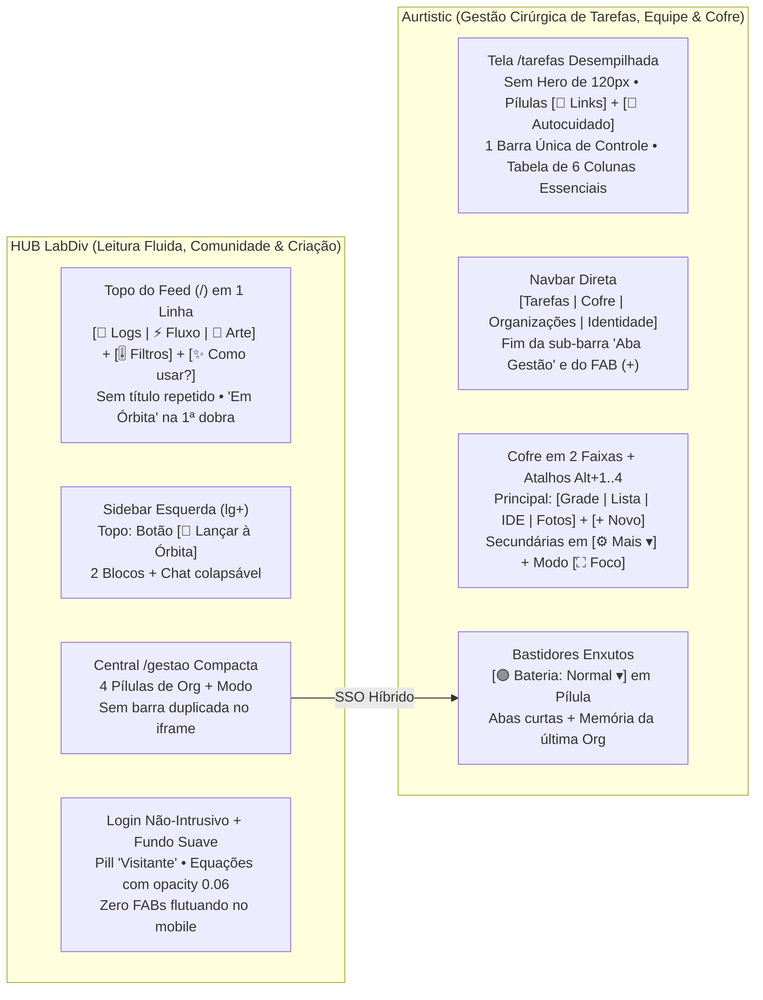

# Plano de Simplificação de Interfaces, Desempilhamento de Telas & Login Contextual (v7.0)

Este documento consolida a **v7.0 completa e aprovada** do plano arquitetural e de experiência do usuário para o **HUB LabDiv** e o **Aurtistic**, integrando:
1. Todas as frentes aprovadas da **v6.0** (Sidebar com `🚀 Lançar à Órbita` no topo, `/gestao` em pílulas, Cofre em 2 faixas com **IDE** principal, Bastidores enxutos, Login Contextual Não-Intrusivo e os 4 bônus de produtividade).
2. **Frente 1.6 (HUB LabDiv — Topo do Feed `/`, Banner Retrátil, Background Científico Suave e Fim dos FABs Mobile)**.
3. **Frente 2.7 (Aurtistic — Desempilhamento dos 6 Andares da Tela Principal de Tarefas, Pílulas de Links/Autocuidado, Barra Única de Controle e Tabela Limpa de 6 Colunas)**.
4. **Sugestões Extras Aprovadas da Seção 6 (Densidade compacta, Check+Ação unificados, chip `[ 👤 Só Minhas ]`, troca inline de Status/Prioridade e atalhos `N` e `/`)**.

---

## 1. Visão Geral da Nova Arquitetura de Interface (v7.0)

---

## 2. Frente 1 — HUB LabDiv: Sidebar Opção B, Topo do Feed (`/`), `/gestao` e Background

| # | Componente / Arquivo | Como Está Hoje | Como Ficará na v7.0 (Simplificado) |
| :- | :--- | :--- | :--- |
| **1.1** | **Botão `🚀 Lançar à Órbita` no Topo da Sidebar (Opção B)** [SidebarLeft.tsx](file:///home/stangorlini/HUB%20LabDiv/src/components/layout/SidebarLeft.tsx) [MainLayoutWrapper.tsx](file:///home/stangorlini/HUB%20LabDiv/src/components/layout/MainLayoutWrapper.tsx#L69-L90) [MainLayoutWrapper.tsx](file:///home/stangorlini/HUB%20LabDiv/src/components/layout/MainLayoutWrapper.tsx#L183-L195) | Botão flutuante (`fixed bottom-8 right-8`) no canto inferior direito que cobre o iframe em `/gestao`, e dock mobile exibido até `1280px`. | • **No topo da `SidebarLeft`**: Botão primário **`[ 🚀 Lançar à Órbita ]`** (vira botão circular `🚀` quando recolhida em `80px`). • **Remoção do FAB inferior direito** no desktop. • **Ajuste de Breakpoint (`xl` → `lg` / `1024px`)**: Sidebar ativa a partir de `1024px`; `BottomNavBar` restrito a `< 1024px` e oculto em `/gestao`. |
| **1.2** | **Enxugamento da Sidebar Esquerda (De 5 Blocos para 2)** [SidebarLeft.tsx](file:///home/stangorlini/HUB%20LabDiv/src/components/layout/SidebarLeft.tsx#L46-L220) | 5 seções empilhadas: `Navegação`, `Central de Interações`, `Partículas Emaranhadas`, `Suporte WhatsApp/E-mail` e `Links secundários`. | • **Bloco 1 (Principal):** Botão `🚀 Lançar`, `Social`, `Informativo`, `Ferramentas`, `Meu Laboratório (/lab)` e `Eixo 4: Gestão (/gestao)`. • **Bloco 2 (Comunicação Expansível):** `💬 Emaranhamento & Pergunte` recolhido por padrão em acordeão limpo. • **Suporte (WhatsApp/E-mail):** Movido para o menu de Ajuda/Rodapé. |
| **1.3** | **Pílula `[ WIKI \| INSTITUTO \| INTERATIVO ]` Sem Sobrepor Cards** [GcifSubNav.tsx](file:///home/stangorlini/HUB%20LabDiv/src/components/layout/GcifSubNav.tsx#L89-L99) | `sticky top-16` com fundo transparente flutuando por cima dos textos dos cards de notícias ao rolar. | Barra de navegação acoplada com `backdrop-blur-xl bg-white/90 dark:bg-background-dark/90 border-b`, sem cortar os cards abaixo. |
| **1.4** | **Central `/gestao` em Faixa Única + Fim da Barra Duplicada** [GestaoClient.tsx](file:///home/stangorlini/HUB%20LabDiv/src/app/gestao/GestaoClient.tsx#L335-L545) [AurtisticOrgEmbedFrame.tsx](file:///home/stangorlini/HUB%20LabDiv/src/components/aurtistic/AurtisticOrgEmbedFrame.tsx#L340-L413) | Banner gigante + 4 cards altos de organização (~220px) + barra extra duplicada colada no iframe. | • Os 4 cards viram **4 Pílulas Horizontais com a cor da IDV** (`[ •• LabDiv ]`, `[ ⚡ Show ]`, `[ 🎓 ProFis ]`, `[ >_ HS ]`) na mesma barra de `[ Bastidores \| 🎨 HUB Studio \| 🛡️ Admin ]`. • Em `/gestao`, a barra interna duplicada do `AurtisticOrgEmbedFrame` fica oculta (mantendo apenas `[ ⛶ Foco ]` e `↗ Nova aba`), abrindo o painel **100% na primeira dobra**. |
| **1.5** | **HUB Studio em 3 Abas Laterais Sem Rolagem** [OrganizationPostStudio.tsx](file:///home/stangorlini/Aurtistic/src/components/organizacoes/studio/OrganizationPostStudio.tsx) | Múltiplos accordions empilhados na esquerda que exigem rolar a página inteira enquanto edita o post. | Coluna esquerda dividida em 3 abas diretas: **`1. Mídia & Recorte`** → **`2. Texto & Slides`** → **`3. Exportar / Publicar`**, mantendo o Canvas do Post fixo o tempo todo. |
| **1.6** | **Limpeza do Topo do Feed (`/`), Banner Retrátil, Fundo Científico e FABs Mobile** [HomeClientView.tsx](file:///home/stangorlini/HUB%20LabDiv/src/components/layout/HomeClientView.tsx#L478-L630) [OnboardingBanner.tsx](file:///home/stangorlini/HUB%20LabDiv/src/components/onboarding/OnboardingBanner.tsx#L64-L175) [globals.css](file:///home/stangorlini/HUB%20LabDiv/src/app/globals.css#L126-L179) [Header.tsx](file:///home/stangorlini/HUB%20LabDiv/src/components/layout/Header.tsx#L391-L413) | • Abaixo de `[ LOGS \| FLUXO \| ARTE ]`, há um título gigante repetido `⚡ FLUXO` (`L576-L589`) / `🎨 ARTE` (`L561-L574`), 2 linhas de texto e o botão `[ FILTROS ]` isolado (~200px verticais antes dos posts). • Banner `"COMO USAR O HUB?"` empurra o feed ou some sem pílula de reabertura. • Equações de fundo (`body::before` em `globals.css`) usam `opacity: 0.75` + `brightness(1.5) contrast(1.2)`, colidindo com textos. • 2 FABs mobile (`☀️` e `🚨` em `top: 76px`) flutuam sobre títulos. | **1. Topo do Feed em 1 Única Linha Compacta (`HomeClientView.tsx`):** • Remover o título gigante repetido `⚡ FLUXO` / `🎨 ARTE` e o parágrafo fixo. • Alinhar na mesma linha horizontal: **Esquerda:** `[ 💬 Logs \| ⚡ Fluxo \| 🎨 Arte ]`; **Direita:** `[ 🎚️ Filtros ▾ ]` + `[ ✨ Como usar o HUB? ]`, fazendo `EM ÓRBITA NO IFUSP` subir imediatamente para a 1ª dobra. **2. Banner `"COMO USAR O HUB?"` Retrátil (`OnboardingBanner.tsx`):** • Se fechado pelo usuário (ou após o 1º acesso), recolhe-se no botão pílula discreto `[ ✨ Como usar o HUB? ]` no topo do feed, abrindo os 3 guias (`Geral`, `Eixo`, `Aba`) sob demanda sem empurrar os posts. **3. Fórmulas Físicas do Background Suaves (`globals.css` `L163-L178`):** • Reduzir a opacidade de `body::before` (`/bg-if.svg`, etc.) para **`0.06` no dark** e **`0.12` no light** com `pointer-events: none` e sem `brightness(1.5)`. **4. Fim dos Botões Flutuantes Mobile (`Header.tsx` `L391-L413`):** • Mover os botões de Tema (`☀️/🌙`) e Reportar (`🚨`) para dentro do `Header` superior, deixando **0 botões flutuando** sobre o conteúdo no mobile. |

---

## 3. Frente 2 — Aurtistic: Desempilhamento de `/tarefas`, Cofre (`IDE` Principal) e Bastidores

> [!IMPORTANT]
> **Regras Inegociáveis desta Frente:**
> 1. **Desempilhamento de `/tarefas`:** Redução dos **6 andares empilhados** antes da 1ª tarefa para **1 faixa de pílulas compactas + 1 barra única de controle** e tabela limpa com **6 colunas essenciais** por padrão.
> 2. **Preservação Integral da IDE no Cofre:** O modo **`IDE`** continua como botão principal de 1 clique na barra primária (`[ Grade | Lista | IDE | Fotos ]`), enquanto ferramentas secundárias vão para `[ ⚙️ Mais ▾ ]`.

| # | Componente / Arquivo | Como Está Hoje | Como Ficará na v7.0 (Simplificado) |
| :- | :--- | :--- | :--- |
| **2.1** | **Promoção de `Cofre` e `Organizações` para a Navbar Principal** [AurtisticNavbar.tsx](file:///home/stangorlini/Aurtistic/src/components/dashboard/AurtisticNavbar.tsx) [UserVaultWorkspace.tsx](file:///home/stangorlini/Aurtistic/src/components/servidor/UserVaultWorkspace.tsx#L2268-L2302) [LabDivWorkspaceClient.tsx](file:///home/stangorlini/Aurtistic/src/components/organizacoes/LabDivWorkspaceClient.tsx#L253-L276) | Navbar tem apenas `Gestão`, obrigando o Cofre e as Organizações a renderizarem uma 2ª barra (`Aba Gestão: [ Cofre \| Organizações ]`). | • Navbar principal exibe diretamente: **`Tarefas` \| `Cofre` \| `Organizações` \| `Identidade ▾`**. • **Eliminação total** da barra secundária `Aba Gestão` em `/servidor` e `/labdiv`. |
| **2.2** | **Cofre de Arquivos: De 7 Barras para 2 (`IDE` Principal + `[ ⚙️ Mais ▾ ]`)** [UserVaultWorkspace.tsx](file:///home/stangorlini/Aurtistic/src/components/servidor/UserVaultWorkspace.tsx#L2300-L2945) | 7 faixas horizontais empilhadas antes da 1ª pasta. | • **Faixa 1 (Contexto & Visão Principal):**   - Esquerda: Dropdown **`[ 📁 Cofre: Pessoal ▾ ]`** + Pílulas (`Arquivos`, `Links (${n})`, `Lixeira`).   - Direita: Seletor Principal **`[ Grade \| Lista \| IDE \| Fotos ]`** + **`[ + Novo ▾ ]`** + **`[ ◨ Painel ]`** + **`[ ⛶ Foco ]`** + Menu **`[ ⚙️ Mais ▾ ]`** (`Sincronizar HUB`, `Gerenciador de Uploads`, `Recarregar`, `Quotas Admin`, `Telemetria HW`). • **Faixa 2 (Breadcrumb Compacto):** `📁 Meus Arquivos > Portfolio` com quota sutil `9.6 GB / 500 GB` à direita. |
| **2.3** | **Menu de Contexto de Pastas Compacto** [VaultContextMenu.tsx](file:///home/stangorlini/Aurtistic/src/components/servidor/VaultContextMenu.tsx#L400-L510) | 10 linhas verticais longas. | Barra rápida de ícones no topo (`[ ⭐ ] [ 🎨 ] [ 📁 ] [ 🔒 ]`) + 5 ações em lista (`Abrir`, `Renomear`, `Criar Atalho...`, `Compartilhar / ZIP`, `Lixeira`). |
| **2.4** | **Bateria Cognitiva em Pílula + Header Enxuto** [LabDivWorkspaceClient.tsx](file:///home/stangorlini/Aurtistic/src/components/organizacoes/LabDivWorkspaceClient.tsx#L354-L383) | Card grande sempre aberto (`MINHA BATERIA COGNITIVA`) empurrando o cabeçalho. | Pílula interativa **`[ 🟢 Bateria: Normal ▾ ]`** que abre `Normal`, `Reduzida`, `Esgotada` e `+ Nota` em um popover flutuante ao clicar. |
| **2.5** | **Abas de Bastidores com Rótulos Curtos e Adaptativos** [LabDivWorkspaceClient.tsx](file:///home/stangorlini/Aurtistic/src/components/organizacoes/LabDivWorkspaceClient.tsx#L398-L478) | 6 abas longas numeradas que geram scroll horizontal. | Rótulos diretos que cabem sem rolagem: `📋 Tarefas & Metas`, `📅 Escalas & Reuniões`, `🔧 Estoque & Pedidos`, `📁 Cofre & POPs`, `👥 Equipe`, e `📡 Telão Ao Vivo`. |
| **2.6** | **Modal de Tarefas em 2 Níveis (Básico Visível + Avançado Expansível)** [TaskFormModal.tsx](file:///home/stangorlini/Aurtistic/src/components/dashboard/TaskFormModal.tsx) | Todos os campos abertos simultaneamente. | Campos principais visíveis de imediato (`Título`, `Status`, `Prioridade`, `Prazo`, `Delegação` e `Subtarefas`) + seção expansível **`[ + Opções Avançadas (Recorrência, Anexos do Cofre, Campos Extras) ]`**. |
| **2.7** | **Desempilhamento Completo da Tela Principal de Tarefas (`/tarefas`)** [AurtisticWorkspaceClient.tsx](file:///home/stangorlini/Aurtistic/src/components/dashboard/AurtisticWorkspaceClient.tsx#L190-L405) [AurtisticQuickLinks.tsx](file:///home/stangorlini/Aurtistic/src/components/dashboard/AurtisticQuickLinks.tsx#L127-L185) [SelfCareHub.tsx](file:///home/stangorlini/Aurtistic/src/components/cuidados/SelfCareHub.tsx#L131-L215) [TasksView.tsx](file:///home/stangorlini/Aurtistic/src/components/dashboard/TasksView.tsx#L1580-L1940) [TasksView.tsx](file:///home/stangorlini/Aurtistic/src/components/dashboard/TasksView.tsx#L2352-L2425) [TasksView.tsx](file:///home/stangorlini/Aurtistic/src/components/dashboard/TasksView.tsx#L2802-L2857) | **6 andares de caixas empilhadas antes da 1ª tarefa:** 1. Hero gigante `Aurtistic creative manager` (`L190-L218`, 120px). 2. Pílula isolada `[ Tarefas \| Eventos \| Ambos ]` (`L337-L375`). 3. Card largo `Links Rápidos` (~70px). 4. Card largo `Autocuidado & Interocepção` (~70px). 5. Barra de Escopo/Visão/Criar. 6. Tabela com **14 colunas abertas** (`min-w-[1400px]`), ícones `( ? )` nos cabeçalhos e botões flutuantes `( + )` e `( ↓ )` no canto inferior direito. | **1. Fim do Banner Hero Gigante no Uso Diário (`AurtisticWorkspaceClient.tsx`):** • Remover o bloco de título/subtítulo de 120px. • Mover `Compartilhar Espaço` e `Montar Espaço` de forma compacta para a faixa superior direita. **2. `Links Rápidos` e `Autocuidado` Compactados em Pílulas na Mesma Linha (`AurtisticQuickLinks.tsx`, `SelfCareHub.tsx`):** • Quando recolhidos, renderizam como **duas pílulas horizontais compactas na mesma linha** (`[ 🔗 Links Rápidos (6) ▾ ]` e `[ 🪷 Autocuidado ▾ ]`, junto com `Compartilhar` e `Montar Espaço` à direita), expandindo o painel completo apenas quando clicadas. **3. Caixa de Controle de Tarefas em 1 Barra Limpa (`TasksView.tsx`):** • **Esquerda:** Escopo (`[ 🌍 Tudo \| 👤 Individual \| 🏢 LabDiv ▾ ]`) + Tipo (`[ ✓ Tarefas \| 📅 Eventos \| Ambos ]`). • **Direita:** Visão (`[ ☷ Lista \| ▥ Semanal \| 📅 Mensal ]`) + `[ 🎚️ Filtros ▾ ]` + `[ ▥ Colunas ▾ ]` + `[ 🎯 Foco ]` + Botão Primário Único **`[ ⚡ Criar ▾ ]`** (abre Tarefa, Evento ou Rascunho Rápido). **4. Remoção dos Botões Flutuantes Redundantes `( + )`, `( ↑ )`, `( ↓ )` e Pílula Inferior Duplicada (`TasksView.tsx` `L2802-L2857`, `AurtisticNavbar.tsx` `L469`):** • Remover os botões flutuantes amarelos/roxos do canto inferior direito que cobrem as linhas da tabela. • Ocultar a pílula flutuante inferior quando a Navbar superior estiver visível. **5. Tabela Desktop Limpa por Padrão (De 14 Colunas para as Essenciais):** • Exibir por padrão apenas: `Ação/Check`, `Nome`, `Status`, `Prioridade`, `Responsável / Equipe`, `Prazo` e `Dimensão` (as colunas secundárias `Categoria`, `Criada em`, `Início`, `Dias restantes`, `Concluída em` e `Freq.` ficam desmarcadas por padrão e ativáveis a qualquer momento no menu **`[ ▥ Colunas ▾ ]`**). • Remover os ícones redondos `( ? )` (`help`) dos cabeçalhos, exibindo a explicação em *tooltip* suave ao passar o mouse sobre o nome da coluna. |

---

## 4. Frente 3 — Login Contextual Não-Intrusivo ("Progressive Auth UX")

1. **Camada 1 — Pílula Explícita no Header ([Header.tsx](file:///home/stangorlini/HUB%20LabDiv/src/components/layout/Header.tsx#L364-L384) e [AurtisticNavbar.tsx](file:///home/stangorlini/Aurtistic/src/components/dashboard/AurtisticNavbar.tsx)):**
   - Quando deslogado, exibe **`[ 👀 Visitante | 🔑 Entrar no HUB → ]`** com *tooltip* leve explicando que a leitura é 100% livre e que o login libera publicações, Emaranhamento e Eixo 4.
2. **Camada 2 — Card Compacto de Boas-Vindas na Sidebar ([SidebarLeft.tsx](file:///home/stangorlini/HUB%20LabDiv/src/components/layout/SidebarLeft.tsx)):**
   - Para deslogados, exibe no topo da Sidebar: `🚀 Faça parte do HUB — Publique projetos, salve materiais e acesse sua organização` + botão `[ Entrar / Criar Conta → ]` preservando `?next=`.
3. **Camada 3 — "Soft-Gates" Contextuais no Clique:**
   - Ao clicar em ações exclusivas de membros (`Lançar`, `Pergunte`, `Painel do Membro`) enquanto visitante, abre um popover contextual convidando a logar com retorno para a mesma página (`?next=`), sem interromper quem quer continuar apenas lendo.
4. **Camada 4 — Card de Credenciamento Claro em `/gestao` e `AurtisticOrgEmbedFrame` ([AurtisticOrgEmbedFrame.tsx](file:///home/stangorlini/HUB%20LabDiv/src/components/aurtistic/AurtisticOrgEmbedFrame.tsx#L420-L424)):**
   - Se aberto sem login, exibe um Card Institucional claro com botão **`[ 🔑 Fazer Login no HUB para liberar o Painel ]`** que retorna direto para `?next=/gestao?org=<slug>`.

---

## 5. Frente 4 — Bônus da v6.0 Aprovados e Integrados

1. **Unificação dos Botões Flutuantes Mobile (`☀️` e `🚨`) no Header (`Header.tsx`):** Integrado na Frente `1.6.4`.
2. **Atalhos de Teclado Diretos no Cofre e na IDE (`UserVaultWorkspace.tsx`):**
   - `Alt + 1` (`Grade`), `Alt + 2` (`Lista`), `Alt + 3` (**`IDE`**), `Alt + 4` (`Fotos`), `Alt + B` (Mostrar/Ocultar Painel lateral).
3. **Memória Automática da Última Organização e Aba (`localStorage`):**
   - Lembrar automaticamente a última organização (`LabDiv`, `Show`, `ProFis`, `HS`) e sub-aba operacional aberta em `/labdiv` e `/gestao` quando não houver `?org=` explícito na URL.
4. **Botão `[ ⛶ Foco ]` (`100vh`) na IDE do Cofre e nos Bastidores:**
   - Recolhe cabeçalhos externos e expande a área útil da IDE ou do Quadro de Bastidores para `100vh` (saindo com `Esc` ou clique).

---

## 6. Frente 5 — Sugestões Extras v7.0 Aprovadas

| # | Sugestão Extra v7.0 | Implementação Prática |
| :- | :--- | :--- |
| **6.1** | **Unificar `Check` + `Ação` em 1 Coluna Compacta (`64px`) e Densidade `py-2.5` na Tabela** | • Coluna única de `64px`: `[ ☐ | ✏️ ]` lado a lado na mesma célula. • Linhas com `py-2.5 px-3` (em vez de `p-4`), liberando **+96px horizontais** e acomodando **~45% mais tarefas na primeira dobra**. |
| **6.2** | **Chip Rápido de 1 Clique `[ 👤 Só Minhas ]` na Barra de Tarefas** | • Botão pílula ao lado de `[ 🎯 Foco ]` que filtra instantaneamente as tarefas atribuídas ao usuário ou à sua subequipe no escopo atual. |
| **6.3** | **Troca Rápida de `Status` e `Prioridade` Direto na Linha (*Inline Popover*)** | • Clicar no badge de `Status` ou `Prioridade` abre mini-seletor rápido sem precisar abrir o modal de edição completo da tarefa. |
| **6.4** | **Atalhos Globais de Teclado `N` e `/` na Tela de Tarefas** | • Pressionar `N` (sem input focado) dispara o modal de Nova Tarefa. • Pressionar `/` foca instantaneamente o campo de busca/filtro de tarefas. |

---

## 7. Roteiro de Execução e Verificação

1. **Passo 1 — HUB LabDiv:**
   - Implementar Frentes 1.1 a 1.6, Login Contextual (Frente 3), remoção de FABs e ajuste de opacidade de fundo (`0.06`).
2. **Passo 2 — Aurtistic (Tarefas):**
   - Desempilhar `/tarefas` (Frente 2.7), pílulas de Links e Autocuidado, barra única de controle, tabela limpa de 6 colunas e bônus 6.1 a 6.4.
3. **Passo 3 — Aurtistic (Cofre, Bastidores & Studio):**
   - Navbar direta (Frente 2.1), Cofre 2 faixas com `IDE` principal + atalhos `Alt+1..4` (Frente 2.2), Bateria cognitiva em pílula (Frente 2.4), Abas curtas (Frente 2.5) e HUB Studio em 3 abas (Frente 1.5).
4. **Passo 4 — Validação Estrita (`Exit 0`):**
   - **Aurtistic:** `npm run verify:full`
   - **HUB LabDiv:** `npx tsc --noEmit && npx eslint src --quiet`
   - Atualização de `.context/ACTIVE_STATE.md` e entrega do Walkthrough Antes/Depois.

