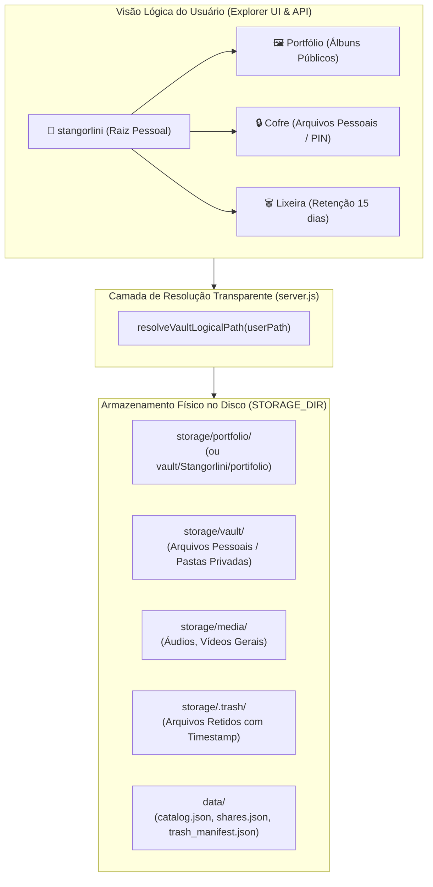

# 🏛️ Arquitetura do Sistema — Fire Stick Storage & Portfolio Portal

> **Documento de Especificação Técnica e Arquitetural (V12.0)**  
> Este documento fornece todos os fundamentos, decisões de design, modelo de dados, mapeamento de armazenamento e módulos internos do sistema para que qualquer engenheiro ou agente de IA (em qualquer workspace) compreenda e opere a base de código integralmente.

---

## 1. Visão Geral e Restrições de Hardware

O sistema foi concebido para atuar como um **servidor pessoal híbrido (Armazenamento em Nuvem Pessoal + Portfólio Fotográfico de Alta Performance)** rodando diretamente sobre hardware de baixo consumo e recursos computacionais severamente limitados:

| Componente | Especificação no Ambiente de Produção |
| :--- | :--- |
| **Dispositivo Host** | Amazon Fire TV Stick 4K / Lite (Processador Quad-core ARM Cortex-A53 @ 1.7 GHz) |
| **Memória RAM Total** | 1.0 GB a 1.5 GB compartilhados com o sistema operacional Android / FireOS |
| **Teto de RAM do Node.js** | **< 200 MB** em pico de carga; **< 65 MB** em repouso (*idle*) |
| **Ambiente de Execução** | Termux userland (POSIX / Linux environment sem root) |
| **Armazenamento Primário** | HD Externo USB 3.0 / SSD conectado via cabo OTG Splitter (NTFS/ext4) |
| **Ponto de Montagem Android** | `/storage/XXXX-XXXX/Android/data/com.termux/files/hub_data` (Acesso direto sem FUSE block) |
| **Conectividade Externa** | Cloudflare Tunnel (`cloudflared`) em loopback -> `storage.hublabdiv.com.br` |
| **Conectividade Local (LAN)** | Wi-Fi 5 GHz 802.11ac -> Acesso direto via IP local (ex.: `http://192.168.0.190:8080`) |
| **Serviço de Rede Nativo** | Servidor WebDAV RFC 4918 para montagem direta no Windows Explorer e Mac Finder |

### Princípios Cardeais de Engenharia:
1. **Zero Native C++ Modules:** Nenhuma dependência com compilação `node-gyp` (como `bcrypt` ou `sharp`), pois quebram na compilação cruzada do Termux/Android. Toda a criptografia utiliza `crypto` nativo do Node.js (`crypto.scryptSync`, `crypto.randomBytes`).
2. **Streaming-First (Chunked I/O):** Nenhum arquivo grande (vídeos, áudios, zips) pode ser carregado integralmente em buffer de memória. Todo I/O utiliza Streams com chunks de 64 KB e respostas HTTP 206 (*Partial Content*).
3. **Zero CPU Compression:** As exportações de arquivos compactados (.ZIP) utilizam o método `STORE` (compressão 0 via `fflate.ZipPassThrough`), entregando velocidade máxima de transferência sem saturar os núcleos ARM.
4. **Resiliência a Quedas de Energia:** Escritas críticas em disco são realizadas com padrão atômico (`.tmp` + rename).

---

## 2. Topologia de Armazenamento: Físico vs. Lógico

O sistema unifica a experiência do usuário em uma única raiz limpa (`stangorlini`), ocultando a complexidade das partições internas do disco.



### Mapeamento Físico de Pastas
- **`portfolio/`**: Contém as pastas organizadas por eventos fotográficos (ex.: `EVENTOS/`, `FESTAS/`, `POLÍTICAS/`). Alimenta a galeria pública de alta velocidade (*Pic-Time style*).
- **`vault/`**: Diretório privado de arquivos pessoais, projetos, documentos e planilhas.
- **`media/`**: Mídias multimídia auxiliares.
- **`.trash/`**: Diretório oculto de segurança gerenciado pelo `TrashManager`. Arquivos excluídos são renomeados para `<timestamp>_<nome_original>` e retidos por 15 dias antes da purga.
- **`data/`**: Diretório de metadados internos fora do volume de arquivos, contendo os índices JSON.

---

## 3. Modelo de Dados e Catálogo em Memória (`catalog.json`)

Para garantir latência de resposta $O(1)$ sem depender de um banco relacional pesado (como PostgreSQL ou MySQL rodando no Fire Stick), o estado do catálogo fotográfico e as personalizações visuais são mantidos em cache na memória do processo (`memoryCatalog`) e sincronizados atomicamente no arquivo `data/catalog.json`.

### Estrutura do Objeto `memoryCatalog`:
```typescript
interface CatalogSchema {
  version: number;               // Versão do schema (ex.: 2)
  generatedAt: string;           // ISO 8601 da última indexação
  items: PortfolioItem[];        // Lista de todas as fotos catalogadas
  albums: string[];              // Nomes dos álbuns raiz (ex.: ["EVENTOS", "FESTAS"])
  subalbums: Record<string, string[]>; // Mapeamento Album -> Subálbuns
  settings: {
    portfolioEnabled: boolean;   // Chave mestre do Portfólio público (true | false)
    layout: {
      folderMeta: Record<string, FolderMetadata>; // Metadados por pasta
    };
    vaultFileMeta: Record<string, VaultFileMetadata>; // Metadados de arquivos fora do portfólio
  };
}

interface FolderMetadata {
  icon?: string;         // Nome do ícone (ex.: "photo_camera", "lock", "work")
  color?: string;        // Hex da cor (ex.: "#FFB703", "#E63946")
  inPortfolio?: boolean; // Se deve ser exposta na galeria pública
  pinProtected?: boolean;// Se a pasta exige autenticação por PIN
}

interface VaultFileMetadata {
  favorite?: boolean;    // Se o arquivo foi marcado com estrela (⭐)
  tags?: string[];       // Tags associadas (ex.: ["#documento", "#prioridade"])
}
```

### Normalização Canônica de Escopos (`normalizeFolderScopeKey`):
As pastas podem ser requisitadas de diferentes origens (WebDAV, rota `/api/vault`, rota `/api/portfolio`). Para garantir que a personalização de cores, ícones e tags seja 100% consistente, utiliza-se a normalização:
- `portfolio/EVENTOS/SHOW` -> `EVENTOS::SHOW`
- `stangorlini/Portfólio/EVENTOS` -> `EVENTOS`
- `portfolio` ou `stangorlini/Portfólio` -> `__ROOT_PORTFOLIO__`
- `stangorlini/Cofre/Projetos` -> `Cofre::Projetos`

---

## 4. Módulos Internos (`lib/`)

A pasta `lib/` foi concebida de forma modular, com responsabilidade única por componente:

| Módulo | Arquivo | Responsabilidade |
| :--- | :--- | :--- |
| **Atomic Store** | `lib/atomic-store.js` | Persistência atômica de arquivos JSON com gravação em `.tmp` seguida de `fs.renameSync`. Previne corrupção em caso de queda de energia do Fire Stick. |
| **Deduplicador** | `lib/deduplicator.js` | Varredura de arquivos duplicados por tamanho e cálculo de hash SHA-256 via streaming por blocos; conversão em atalhos virtuais sem consumo de bytes. |
| **Cofre Criptográfico (PIN)** | `lib/pin-vault.js` | Proteção de pastas com senha/PIN via `crypto.scryptSync` nativo. Formato de armazenamento: `salt:hash`. Suporta primeiro acesso, alteração e remoção. |
| **Motor de Busca** | `lib/search-engine.js` | Indexador de arquivos, extensões e tags (`#tag`), operando buscas tokenizadas em tempo real sobre a árvore de diretórios e o catálogo. |
| **Gerenciador de Links** | `lib/share-manager.js` | Emissão de links compartilháveis temporários (`/s/:token`), modos de permissão (`view`, `proofing`, `upload_only`), expiração e feedback de clientes (`#selecionadas`). |
| **Atalhos Virtuais** | `lib/shortcut-manager.js` | Criação e leitura de ponteiros leves (`.shortcut.json`) para espelhar arquivos em múltiplos álbuns sem duplicação física no HD. |
| **Lixeira Centralizada** | `lib/trash-manager.js` | Fila de exclusão segura com retenção de 15 dias, manifesto atômico (`trash_manifest.json`), restauração para o caminho de origem e expurgo definitivo. |
| **Servidor WebDAV** | `lib/webdav-server.js` | Implementação RFC 4918 completa (PROPFIND 207 Multi-Status, GET, PUT, MKCOL, DELETE, MOVE, COPY) com Basic Auth e redirecionamento de deleções para a Lixeira. |
| **Exportador ZIP** | `lib/zip-exporter.js` | Empacotamento de diretórios em formato .ZIP sob demanda via streaming contínuo (`fflate.ZipPassThrough` no modo STORE), sem buffer de RAM. |

---

## 5. Arquitetura de Rede e Protocolo WebDAV (RFC 4918)

O sistema expõe o protocolo WebDAV nativamente no endpoint `/webdav/`, transformando o Fire Stick em um **disco de rede (NAS)** acessível diretamente pelo explorador de arquivos dos sistemas operacionais:

```
[Windows Explorer] (Win + E -> Mapear Unidade de Rede) ────┐
[macOS Finder]    (Cmd + K -> Conectar ao Servidor)    ───┼──> [http://192.168.0.190:8080/webdav]
[Linux Nautilus]  (Outros Locais -> dav://...)         ───┤           │
[Mobile VLC / MiXplorer] (Conexão WebDAV LAN)          ───┘           ▼
                                                              [lib/webdav-server.js]
                                                                      │
                                                      ┌───────────────┴───────────────┐
                                                      ▼                               ▼
                                              Leitura / Escrita              Deleção Segura
                                            (storage/ diretamente)          (lib/trash-manager.js)
```

### Segurança e Tratamento de Métodos WebDAV:
- **Autenticação:** HTTP Basic Auth exigindo usuário `admin` (ou qualquer identificador) e a senha definida em `ADMIN_PASSWORD` no `.env`.
- **CORS Bypass:** O middleware do WebDAV é registrado **antes** do middleware `cors()` no Express, garantindo que o método `OPTIONS` responda com os cabeçalhos de conformidade RFC:
  ```http
  DAV: 1, 2
  MS-Author-Via: DAV
  Allow: OPTIONS, GET, HEAD, POST, PUT, DELETE, TRACE, PROPFIND, PROPPATCH, COPY, MOVE, MKCOL
  ```
- **Proteção da Lixeira:** Quando o usuário clica em "Excluir" em uma pasta montada no Windows ou Mac, o método `DELETE` do WebDAV não destrói o arquivo fisicamente; ele invoca o `TrashManager.moveToTrash()`, garantindo a janela de segurança de 15 dias para recuperação.

---

## 6. Mecanismos de Sessão e Controle de Acesso

O servidor **não depende de pacotes pesados como `express-session`**. Ele implementa um gerenciador de sessão ultraleve em memória (`activeUnlockedFoldersByToken`):

1. **Token de Sessão:** O cliente web envia um cookie ou cabeçalho `x-session-token` (ou gera automaticamente via `crypto.randomBytes`).
2. **Sessão em Memória:** O servidor mantém um `Map<sessionToken, Set<unlockedFolderKey>>`.
3. **Desbloqueio com PIN:** Quando o usuário fornece o PIN correto de uma pasta via `POST /api/vault/pin/verify`, a chave normalizada da pasta é adicionada ao `Set` da sua sessão.
4. **Validação de Acesso:** Rotas de listagem (`/api/vault/list`) e leitura (`/api/vault/read-text`) verificam se o caminho requisitado está contido em alguma subárvore protegida e se o token da requisição atual possui o desbloqueio ativo. Caso contrário, retorna HTTP 403 com `{ pinProtected: true }`.

---

## 7. Estratégia de Streaming e Otimização de Mídia (HTTP 206)

Para reprodução de vídeos em alta definição (`.mp4`, `.mov`, `.mkv`) e áudios (`.mp3`, `.wav`, `.flac`), o backend implementa suporte nativo a *Range Requests*:

$$\text{Range: bytes=start-end}$$

1. O cliente solicita apenas o trecho necessário para inicializar a reprodução ou quando o usuário faz *seek* na barra de progresso.
2. O servidor abre uma `fs.createReadStream(filePath, { start, end })` canalizada diretamente para a resposta HTTP com código **206 Partial Content**.
3. A memória consumida no Fire Stick durante o streaming é delimitada pelo buffer do socket TCP (aproximadamente 64 KB a 128 KB), permitindo que centenas de gigabytes de filmes ou fotos RAW sejam navegados sem nunca esgotar a RAM do aparelho.

