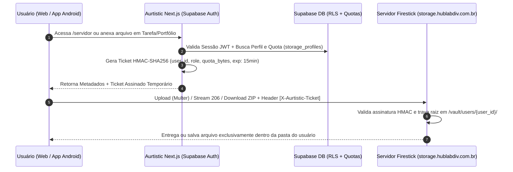

Analisei linha por linha o plano anterior (`unification_firestick_portal_plan.md`), o `package.json` do **Aurtistic** e o `spackage.json` do **Servidor (`firestick-portal`)**, cruzando com os pontos fundamentais que você levantou.

Antes do documento definitivo abaixo, veja as **5 falhas críticas** que identifiquei no plano anterior e que já foram **corrigidas nesta nova versão**:

1. **Isolamento Multi-Usuário (Multi-Tenancy) no Servidor Físico (`server.js`):**
* *O problema:* O servidor do Fire TV Stick (`spackage.json`) foi construído em Express + Multer sem sistema de usuários — qualquer rota listava o HD inteiro.


* *A solução:* Criamos uma arquitetura **Multi-Tenant com Jail (Chroot lógico) por UUID do Supabase**. Todo usuário autenticado no Aurtistic ganha automaticamente seu diretório isolado (`/users/{user_id}/`) no servidor. O usuário A jamais consegue ver, listar ou acessar (`../`) as pastas do usuário B. Apenas contas marcadas como `admin` no perfil têm acesso à aba de Telemetria de Hardware do Fire TV Stick.


2. **Prevenção do Erro `413 Payload Too Large` da Vercel (Limite de 4.5 MB):**
* *O problema:* O plano anterior sugeria passar tudo por Server Actions do Next.js como proxy. Na Vercel (`aurtistic.vercel.app`), funções serverless têm limite estrito de **4.5 MB** por requisição. Se um usuário tentasse subir uma foto RAW/alta resolução (`multer`), baixar um ZIP (`fflate`) ou fazer streaming de vídeo HTTP 206 passando por dentro da Vercel, o app travaria.


* *A solução:* Separamos o **Plano de Controle** (Next.js Server Actions geram um *Ticket Assinado HMAC-SHA256* temporário contendo o `user_id` e a quota do usuário) do **Plano de Dados** (Upload, Download ZIP e Streaming HTTP 206 vão direto do navegador/Android para `[https://storage.hublabdiv.com.br](https://storage.hublabdiv.com.br)` validados pelo Ticket HMAC, sem limite de tamanho e sem expor chaves secretas).


3. **Preservação 100% da Identidade Visual (IDV) do Aurtistic:**
* *O problema:* O plano anterior misturava a paleta e fontes da LabDiv (`#FFCC00`, `#0F4780`, fonte `Bukra`) sobrepondo o visual do Aurtistic.


* *A solução:* Removemos completamente qualquer imposição visual externa. O módulo de Arquivos/Servidor, Galeria e Compartilhamento adota **estritamente** o Design System, variáveis CSS, tipografia, componentes e ergonomia cognitiva (baixa sobrecarga sensorial para autistas) já existentes no **Aurtistic**.


4. **Conexão Real entre Tarefas ↔ Arquivos ↔ Portfólio ↔ Currículo:**
* *O problema:* No plano antigo, as 4 áreas continuavam funcionando como ilhas separadas.


* *A solução:* Agora o banco de dados e a UI permitem:
* **Tarefas + Arquivos:** Anexar qualquer arquivo ou pasta do servidor diretamente a uma Tarefa/Projeto Artístico (e transformar feedbacks de clientes em novas tarefas com 1 clique).
* **Arquivos + Portfólio:** Publicar uma foto/obra que está na pasta pessoal do usuário direto para a vitrine do Portfólio sem precisar fazer novo upload.
* **Arquivos/Portfólio + Currículo:** Vincular certificados, PDFs ou projetos artísticos do cofre pessoal direto nos itens do Currículo interativo.


5. **Auditoria Real do `package.json` vs `spackage.json` (Correção do Build e Gradle):**
* O `package.json` do Aurtistic usa Next.js `16.2.10` (`--webpack`), React `19.2.4`, Capacitor `8.4.1`, Supabase SSR `0.12.0` e Serwist `9.5.11`, e **não possui `zod` instalado** (que o plano anterior tentava importar no código).


* O `spackage.json` usa `express`, `multer`, `cors`, `fflate` e `dotenv` para rodar o daemon `server.js` no Termux/Fire TV Stick. Mantê-lo solto dentro da árvore do Aurtistic faz o Webpack, o ESLint e o Gradle do Android tentarem compilar o servidor Express junto com o app mobile. A nova arquitetura isola o daemon de borda e impede qualquer conflito de build.


---

Abaixo está o **Plano Arquitetural Definitivo (v2.0)** completo. Você pode substituir o conteúdo do seu arquivo `unification_firestick_portal_plan.md` por ele e mandar o agente executar cada fase.

```markdown
# 🧠 Plano Arquitetural Definitivo (v2.0): Unificação do Servidor de Arquivos ao Ecossistema Aurtistic

> **Visão do Produto:** O sistema operacional definitivo para criativos e pessoas autistas/neurodivergentes — unindo **Gerenciador de Tarefas**, **Arquivos Pessoais (Servidor)**, **Portfólio Artístico** e **Currículo Interativo** em um fluxo único, previsível e livre de fricção.  
> **Regra de Ouro de Design:** A Identidade Visual (IDV) do **Aurtistic** é soberana. Todos os recursos vindos do `firestick-portal` são reescritos dentro do Design System nativo do Aurtistic.  
> **Regra de Ouro de Segurança:** Isolamento Multi-Tenant absoluto. Cada usuário autenticado possui seu próprio espaço isolado de pastas no servidor (`chroot` lógico por `user_id`).  
> **Ambiente:** Next.js 16.2.10 (`--webpack`) | React 19.2.4 | Tailwind CSS v4 | Supabase SSR | Capacitor 8.4.1 | Serwist PWA | Edge Daemon Node.js (`express` + `multer` + `fflate`)

---

## 1. Auditoria de Dependências (`package.json` vs `spackage.json`) e Saneamento do Workspace

### 1.1 Análise Cruzada dos Pacotes Atuais

| Pacote / Tecnologia | `aurtistic` (`package.json`) | `servidor` (`spackage.json`) | Destino na Unificação |
| :--- | :--- | :--- | :--- |
| **Framework Core** | `next@16.2.10`, `react@19.2.4` | `express@^4.21.2` | O `Aurtistic` comanda 100% da UI, Auth e BFF. O `express` roda apenas como daemon de API de disco no Fire TV Stick (`server.js`). |
| **Autenticação & DB** | `@supabase/ssr@^0.12.0`, `@supabase/supabase-js@^2.110.1` | Sem perfilamento (senha única `.env`) | O Supabase passa a ser a autoridade única de identidade e permissões para ambos os lados. |
| **Upload & Arquivos** | `xlsx@^0.18.5` | `multer@^1.4.5-lts.2`, `fflate@^0.8.3`, `cors@^2.8.5` | `multer`, `fflate` e `cors` permanecem no daemon `server.js` (com middleware Multi-Tenant). Opcionalmente, `fflate` pode ser adicionado ao Aurtistic se houver descompactação no cliente. |
| **Mobile & PWA** | `@capacitor/*@^8.4.1`, `@serwist/next@^9.5.11` | HTML/CSS estático (`index.html`, `share.html`) | Todo HTML/CSS legado do `firestick-portal` é descartado e recriado em React 19 + Tailwind v4 seguindo a IDV do Aurtistic. |
| **Validação de Dados** | Nativa TypeScript (não há `zod` no `package.json`) | Nativa JS | Usar validadores TypeScript puros (`src/lib/validators.ts`) sem exigir instalação de pacotes extras que sujem a árvore de dependências. |

### 1.2 Correção Imediata do Conflito de Build (Next.js Webpack + Gradle Android)
A presença da pasta `firestick-portal/` com seu próprio `node_modules` e scripts dentro da raiz do `Aurtistic` causa falha no scanner do Gradle (`@capacitor/app/android`) e polui o linter/typechecker do Next.js.

**Ações obrigatórias na Fase 0:**
1. Remover `firestick-portal/node_modules` e `firestick-portal/.git` da árvore do Aurtistic.
2. Mover apenas o `server.js` e `spackage.json` (renomeado para `package.json` dentro de `edge-daemon/`) para uma pasta ignorada pelo Next.js e pelo Capacitor, ou configurar `tsconfig.json` e `eslint.config.mjs` com `exclude: ["firestick-portal/**", "edge-daemon/**", "android/**"]`.
3. Garantir no `@serwist/next` (PWA) que rotas de streaming de mídia (`/api/edge/**` e URLs de `storage.hublabdiv.com.br`) usem estratégia `NetworkOnly` para não estourar o cache do Service Worker com vídeos/fotos pesadas.

---

## 2. Arquitetura de Perfilamento e Isolamento Multi-Tenant (Cada Usuário na Sua Pasta)

Como o servidor físico (`storage.hublabdiv.com.br`) não possuía sistema de usuários, implementaremos o **Isolamento por Namespace Assinado (Signed Chroot Jail)** combinando o Supabase Auth com um middleware no `server.js`.

### 2.1 Como Funciona o Isolamento de Pastas por Usuário



### 2.2 Por que usar Ticket Assinado (HMAC) entre o Aurtistic e o Servidor?

1. **Burla o limite de 4.5 MB da Vercel:** O upload de arquivos grandes (`multer`), o download de álbuns em `.zip` (`fflate`) e o streaming de vídeo/áudio (`HTTP 206`) trafegam direto entre o dispositivo do usuário e `https://storage.hublabdiv.com.br`, sem passar pelo gargalo da Vercel.
2. **Zero Latência no Fire TV Stick:** O Fire TV Stick valida o Ticket matematicamente em `< 0.1ms` usando a função nativa `crypto.createHmac` do Node.js (sem precisar instalar SDK pesado do Supabase no Fire Stick).
3. **Segurança Anti-Path Traversal:** O middleware do `server.js` ignora qualquer tentativa de `../../` e força toda operação de leitura/escrita para dentro de:
* **Pasta Privada do Usuário:** `/MOUNT_PATH/users/{supabase_user_id}/vault/...`
* **Pasta de Portfólio Público do Usuário:** `/MOUNT_PATH/users/{supabase_user_id}/portfolio/...`
* **Visão Admin:** Apenas se o ticket contiver `role: 'admin'` (validado no banco do Aurtistic), o endpoint `/api/telemetry` libera dados de hardware (CPU, RAM, Temperatura e HD global do Fire TV Stick). Usuários comuns veem apenas o consumo da sua própria cota de armazenamento (ex: `2.4 GB usados de 10 GB`).


---

## 3. Sinergia dos 4 Pilares: Vida, Criatividade e Produtividade Neurodivergente

O diferencial do **Aurtistic** não é ter 4 ferramentas soltas, mas permitir que uma pessoa autista ou criativa gerencie sua rotina e sua arte sem sobrecarga executiva:

| Conexão entre Módulos | Fluxo Prático na Interface do Usuário (UX Cognitiva) |
| --- | --- |
| **1. Tarefas ↔ Arquivos Pessoais** | Dentro de qualquer Tarefa (no Kanban ou Lista), o botão **"Anexar do Meu Espaço"** abre um seletor rápido da pasta do usuário no servidor. Uma tarefa como *"Finalizar edição do ensaio X"* ou *"Estudar documento Y"* fica ligada diretamente à pasta ou arquivo correspondente (áudio, PDF, PSD, vídeo, nota `.md`). |
| **2. Arquivos Pessoais ↔ Portfólio** | Dentro do gerenciador de arquivos (`/servidor`), o usuário seleciona qualquer imagem, áudio ou projeto e clica em **"Exibir no Meu Portfólio"**. O item entra imediatamente na vitrine artística (`/portfolio`) com seus metadados EXIF, tags e álbum, sem duplicar o arquivo no disco. |
| **3. Portfólio/Clientes ↔ Tarefas** | Quando um cliente acessa um link de seleção (`/s/[token]`) e aprova suas fotos favoritas, o Aurtistic cria automaticamente uma **Tarefa vinculada** no painel do criativo: *"Cliente [Nome] selecionou X arquivos no álbum [Título]"*, já com a lista filtrada pronta para trabalho. |
| **4. Arquivos/Portfólio ↔ Currículo** | Na edição do Currículo (`/curriculo`), o usuário pode vincular certificados em PDF guardados no seu cofre pessoal ou incorporar uma faixa de destaque do seu Portfólio diretamente como evidência prática de suas habilidades. |

---

## 4. Modelagem de Dados Completa no Supabase

Arquivo de migração: `supabase/migrations/newsqls/01_aurtistic_unified_ecosystem.sql` (respeitando RLS estrito por `auth.uid()` e limite de linhas).

```sql
-- ============================================================================
-- ARQUIVO: supabase/migrations/newsqls/01_aurtistic_unified_ecosystem.sql
-- LICENÇA: AGPLv3
-- OBJETIVO: Perfilamento de Storage por Usuário, Vínculo Tarefas-Arquivos,
--           Portfólio Criativo e Provas de Clientes (/s/:token)
-- ============================================================================

-- 1. ENUMS DO ECOSSISTEMA
DO $$ BEGIN
  CREATE TYPE public.share_mode_enum AS ENUM ('view', 'proofing', 'upload_only');
EXCEPTION WHEN duplicate_object THEN NULL; END $$;

DO $$ BEGIN
  CREATE TYPE public.item_visibility_enum AS ENUM ('public', 'private', 'unlisted');
EXCEPTION WHEN duplicate_object THEN NULL; END $$;

-- 2. PERFIL DE ARMAZENAMENTO POR USUÁRIO (ISOLAMENTO MULTI-TENANT & QUOTAS)
CREATE TABLE IF NOT EXISTS public.user_storage_profiles (
  user_id UUID PRIMARY KEY REFERENCES auth.users(id) ON DELETE CASCADE,
  root_folder_slug TEXT NOT NULL UNIQUE DEFAULT gen_random_uuid()::text,
  storage_role TEXT NOT NULL DEFAULT 'member' CHECK (storage_role IN ('member', 'admin')),
  quota_limit_bytes BIGINT NOT NULL DEFAULT 5368709120, -- 5 GB padrão por usuário
  used_bytes BIGINT NOT NULL DEFAULT 0,
  pinned_folders TEXT[] DEFAULT ARRAY[]::TEXT[],
  preferences JSONB DEFAULT '{"defaultView": "grid", "reducedMotion": true}'::jsonb,
  last_sync_at TIMESTAMPTZ,
  created_at TIMESTAMPTZ NOT NULL DEFAULT timezone('utc'::text, now()),
  updated_at TIMESTAMPTZ NOT NULL DEFAULT timezone('utc'::text, now())
);

-- 3. ÍNDICE DE ARQUIVOS DO USUÁRIO & VÍNCULO COM TAREFAS/CURRÍCULO/PORTFÓLIO
CREATE TABLE IF NOT EXISTS public.user_files_index (
  id UUID PRIMARY KEY DEFAULT gen_random_uuid(),
  user_id UUID NOT NULL REFERENCES auth.users(id) ON DELETE CASCADE,
  relative_path TEXT NOT NULL, -- Caminho sempre relativo à pasta raiz do usuário (/vault/...)
  filename TEXT NOT NULL,
  mime_type TEXT NOT NULL,
  size_bytes BIGINT NOT NULL DEFAULT 0,
  is_directory BOOLEAN NOT NULL DEFAULT false,
  has_pin BOOLEAN NOT NULL DEFAULT false,
  -- Vínculos diretos com o ecossistema Aurtistic
  linked_task_id UUID, -- Referência opcional à tarefa do usuário
  show_in_portfolio BOOLEAN NOT NULL DEFAULT false,
  show_in_curriculum BOOLEAN NOT NULL DEFAULT false,
  -- Metadados Artísticos / Fotográficos (quando aplicável)
  title TEXT,
  description TEXT,
  album TEXT DEFAULT 'Geral',
  category TEXT DEFAULT 'Projeto',
  tags TEXT[] DEFAULT ARRAY[]::TEXT[],
  exif_data JSONB DEFAULT '{}'::jsonb, -- { width, height, camera, lens, iso, aperture, shutter }
  is_favorite BOOLEAN NOT NULL DEFAULT false,
  visibility public.item_visibility_enum NOT NULL DEFAULT 'private',
  display_order INTEGER DEFAULT 0,
  created_at TIMESTAMPTZ NOT NULL DEFAULT timezone('utc'::text, now()),
  updated_at TIMESTAMPTZ NOT NULL DEFAULT timezone('utc'::text, now()),
  UNIQUE(user_id, relative_path)
);

-- 4. LINKS DE COMPARTILHAMENTO E APROVAÇÃO DE PROJETOS (/s/:token)
CREATE TABLE IF NOT EXISTS public.share_links (
  id UUID PRIMARY KEY DEFAULT gen_random_uuid(),
  user_id UUID NOT NULL REFERENCES auth.users(id) ON DELETE CASCADE,
  token TEXT NOT NULL UNIQUE,
  folder_path TEXT NOT NULL, -- Relativo à pasta do usuário criador
  album_title TEXT NOT NULL,
  mode public.share_mode_enum NOT NULL DEFAULT 'proofing',
  pin_hash TEXT,
  allow_download BOOLEAN NOT NULL DEFAULT true,
  expires_at TIMESTAMPTZ,
  client_name TEXT,
  client_feedback TEXT,
  selected_file_paths TEXT[] DEFAULT ARRAY[]::TEXT[],
  auto_create_task BOOLEAN NOT NULL DEFAULT true, -- Cria tarefa no Aurtistic quando o cliente envia
  is_submitted BOOLEAN NOT NULL DEFAULT false,
  submitted_at TIMESTAMPTZ,
  created_at TIMESTAMPTZ NOT NULL DEFAULT timezone('utc'::text, now())
);

-- 5. ÍNDICES DE PERFORMANCE
CREATE INDEX IF NOT EXISTS idx_user_files_user_path ON public.user_files_index(user_id, relative_path);
CREATE INDEX IF NOT EXISTS idx_user_files_task ON public.user_files_index(user_id, linked_task_id) WHERE linked_task_id IS NOT NULL;
CREATE INDEX IF NOT EXISTS idx_user_files_portfolio ON public.user_files_index(user_id, show_in_portfolio, visibility);
CREATE INDEX IF NOT EXISTS idx_share_links_token ON public.share_links(token);

-- 6. ROW LEVEL SECURITY (RLS) - ISOLAMENTO ESTRITO POR USUÁRIO
ALTER TABLE public.user_storage_profiles ENABLE ROW LEVEL SECURITY;
ALTER TABLE public.user_files_index ENABLE ROW LEVEL SECURITY;
ALTER TABLE public.share_links ENABLE ROW LEVEL SECURITY;

-- Políticas de Perfil de Storage
DROP POLICY IF EXISTS "Usuário lê e edita seu próprio perfil de storage" ON public.user_storage_profiles;
CREATE POLICY "Usuário lê e edita seu próprio perfil de storage" ON public.user_storage_profiles
  FOR ALL USING (auth.uid() = user_id);

-- Políticas de Arquivos Indexados e Portfólio
DROP POLICY IF EXISTS "Usuário gerencia exclusivamente seus próprios arquivos" ON public.user_files_index;
CREATE POLICY "Usuário gerencia exclusivamente seus próprios arquivos" ON public.user_files_index
  FOR ALL USING (auth.uid() = user_id);

DROP POLICY IF EXISTS "Visitantes leem apenas itens marcados como portfólio público" ON public.user_files_index;
CREATE POLICY "Visitantes leem apenas itens marcados como portfólio público" ON public.user_files_index
  FOR SELECT USING (show_in_portfolio = true AND visibility = 'public');

-- Políticas de Links de Compartilhamento
DROP POLICY IF EXISTS "Usuário gerencia seus próprios links de compartilhamento" ON public.share_links;
CREATE POLICY "Usuário gerencia seus próprios links de compartilhamento" ON public.share_links
  FOR ALL USING (auth.uid() = user_id);

DROP POLICY IF EXISTS "Acesso público a links de compartilhamento válidos" ON public.share_links;
CREATE POLICY "Acesso público a links de compartilhamento válidos" ON public.share_links
  FOR SELECT USING (expires_at IS NULL OR expires_at > timezone('utc'::text, now()));

-- 7. TRIGGER DE AUTO-PROVISIONAMENTO DE PASTA PARA NOVOS USUÁRIOS
CREATE OR REPLACE FUNCTION public.handle_new_user_storage_profile()
RETURNS TRIGGER
LANGUAGE plpgsql
SECURITY DEFINER
AS $$
BEGIN
  INSERT INTO public.user_storage_profiles (user_id, root_folder_slug)
  VALUES (NEW.id, NEW.id::text)
  ON CONFLICT (user_id) DO NOTHING;
  RETURN NEW;
END;
$$;

DROP TRIGGER IF EXISTS on_auth_user_created_storage ON auth.users;
CREATE TRIGGER on_auth_user_created_storage
  AFTER INSERT ON auth.users
  FOR EACH ROW EXECUTE FUNCTION public.handle_new_user_storage_profile();

```

---

## 5. Adaptação do `server.js` (Servidor Firestick) para Multi-Tenancy

No projeto do servidor (`spackage.json`: `express`, `cors`, `multer`, `fflate`), adicionaremos o **Middleware de Isolamento por Usuário (`tenantAuthMiddleware`)**:

```javascript
// Trecho arquitetural para o server.js do Fire TV Stick
const crypto = require('crypto');
const path = require('path');
const fs = require('fs');

const BASE_STORAGE_ROOT = process.env.STORAGE_ROOT || '/storage/emulated/0/AurtisticVault';
const EDGE_HMAC_SECRET = process.env.EDGE_HMAC_SECRET;

// Valida o Ticket emitido pelo Next.js do Aurtistic e isola o diretório do usuário
function verifyTenantTicket(req, res, next) {
  const rawTicket = req.headers['x-aurtistic-ticket'] || req.query.ticket;
  if (!rawTicket) return res.status(401).json({ error: 'Ticket de sessão ausente' });

  const [payloadB64, signature] = String(rawTicket).split('.');
  if (!payloadB64 || !signature) return res.status(401).json({ error: 'Formato de ticket inválido' });

  const expectedSig = crypto
    .createHmac('sha256', EDGE_HMAC_SECRET)
    .update(payloadB64)
    .digest('base64url');

  if (!crypto.timingSafeEqual(Buffer.from(signature), Buffer.from(expectedSig))) {
    return res.status(403).json({ error: 'Assinatura de ticket inválida' });
  }

  const payload = JSON.parse(Buffer.from(payloadB64, 'base64url').toString('utf8'));
  if (Date.now() > payload.exp) {
    return res.status(401).json({ error: 'Ticket expirado. Atualize a sessão no Aurtistic.' });
  }

  // CHROOT LÓGICO: Garante que o usuário só acesse sua própria pasta
  const userRoot = path.resolve(BASE_STORAGE_ROOT, 'users', String(payload.userId));
  if (!fs.existsSync(userRoot)) {
    fs.mkdirSync(path.join(userRoot, 'Arquivos'), { recursive: true });
    fs.mkdirSync(path.join(userRoot, 'Portfolio'), { recursive: true });
    fs.mkdirSync(path.join(userRoot, 'Curriculo'), { recursive: true });
    fs.mkdirSync(path.join(userRoot, 'Projetos'), { recursive: true });
  }

  req.tenant = {
    userId: payload.userId,
    role: payload.role,
    quotaLimitBytes: payload.quotaLimitBytes,
    userRoot,
    // Helper seguro contra Path Traversal (../)
    resolveSafePath: (relativeSubPath = '') => {
      const cleaned = String(relativeSubPath).replace(/^(\.\.(\/|\\|$))+/, '');
      const target = path.resolve(userRoot, '.' + path.sep + cleaned);
      if (!target.startsWith(userRoot)) {
        throw new Error('Tentativa de acesso fora da pasta do usuário bloqueada.');
      }
      return target;
    },
  };
  next();
}

```

> **Detalhe importante sobre Criação Automática de Pastas:** Assim que um usuário loga no Aurtistic pela primeira vez e abre a aba de Arquivos/Servidor, o sistema provisiona automaticamente 4 pastas organizadoras na conta dele (`Arquivos`, `Portfolio`, `Curriculo`, `Projetos`), facilitando a organização mental para usuários autistas e criativos.

---

## 6. Diretrizes de Interface: 100% Identidade Visual (IDV) do Aurtistic

Toda a interface de Arquivos, Portfólio e Compartilhamento será construída **dentro dos padrões visuais que já existem no Aurtistic**, descartando o CSS antigo do `firestick-portal`:

1. **Tokens de Cor e Superfície Nativos do Aurtistic:**
* Usar exclusivamente as classes e variáveis CSS globais já definidas em `src/app/globals.css` do Aurtistic (mantendo o esquema de cores, bordas arredondadas, espaçamento e contraste que o usuário já conhece nas telas de Tarefas e Currículo).
* **Proibido** introduzir paletas externas, fontes conflitantes ou estilos inline legados do `firestick-portal`.


2. **Design Cognitivo & Acessibilidade para Autistas:**
* **Previsibilidade Espacial:** A barra de navegação (`AurtisticNavbar`) permanece exatamente no mesmo lugar em todas as telas (Tarefas, Resumo, Portfólio, Currículo e Arquivos/Servidor).
* **Zero Sobrecarga Sensorial:** Substituir barras de progresso piscantes por indicadores suaves; manter transições sutis respeitando `prefers-reduced-motion`; evitar modais em cascata (usar gavetas/painéis laterais limpos no estilo do Aurtistic).
* **Ações Contextuais Diretas ("1-Clique"):** Cada card de arquivo tem um menu limpo com 3 ações diretas do ecossistema:
* 📌 *Vincular a uma Tarefa*
* 🎨 *Publicar no Portfólio*
* 📄 *Anexar ao Currículo*


---

## 7. Arquitetura de Componentes no Next.js (`src/`)

```text
src/
├── lib/
│   ├── edge-ticket.ts               # Gerador de Ticket HMAC-SHA256 no servidor Next.js
│   ├── edge-client.ts               # Cliente HTTP para o Firestick (com fallback offline no Supabase)
│   └── validators.ts                # Validação TypeScript pura (sem depender de libs externas)
├── types/
│   ├── storage.ts                   # Tipos de Pastas, Arquivos, Quotas e Tickets Multi-Tenant
│   └── portfolio.ts                 # Tipos de Galeria, EXIF e Provas de Clientes
├── app/
│   ├── (dashboard)/
│   │   └── servidor/
│   │       ├── page.tsx             # Server Component: carrega quota do usuário, ticket e árvore raiz
│   │       └── actions.ts           # Server Actions: vincular arquivo a tarefa, publicar no portfólio, criar link
│   ├── portfolio/
│   │   ├── page.tsx                 # Vitrine unificada (Projetos + Galeria Fotográfica do usuário)
│   │   └── [username]/page.tsx      # Visão pública compartilhável do portfólio de cada usuário
│   └── s/
│       └── [token]/
│           └── page.tsx             # Página limpa (IDV Aurtistic) para clientes aprovarem fotos/arquivos
└── components/
    ├── servidor/
    │   ├── UserVaultWorkspace.tsx   # Gerenciador de pastas isolado do usuário (Upload, ZIP, Notas .md)
    │   ├── FileEcosystemMenu.tsx    # Botões rápidos: "Vincular a Tarefa", "Enviar p/ Portfólio", "Enviar p/ Currículo"
    │   ├── StorageQuotaCard.tsx     # Barra de uso de espaço pessoal do usuário (e Telemetria apenas se Admin)
    │   └── NoteEditorDrawer.tsx     # Editor minimalista de notas .txt/.md integrado ao cofre
    ├── tarefas/
    │   └── TaskFilePickerModal.tsx  # Permite anexar arquivos do servidor diretamente dentro de uma Tarefa
    ├── portfolio/
    │   ├── AurtisticGalleryGrid.tsx # Grid responsivo Passe-Partout integrado ao visual do Aurtistic
    │   └── PhotoInspectModal.tsx    # Lightbox com leitura de metadados EXIF e navegação por teclado
    └── media/
        └── GlobalAudioDock.tsx      # Player discreto no rodapé para ouvir músicas/áudios de trabalho enquanto gerencia tarefas

```

---

## 8. Plano de Execução Sequencial (Passo a Passo)

### Fase 1: Saneamento do Repositório e Correção do Build/Capacitor

* [ ] Isolar a pasta `firestick-portal` do ciclo de build do Next.js e do Gradle: remover `firestick-portal/node_modules` e `firestick-portal/.git`, e adicionar `firestick-portal/**` no `exclude` do `tsconfig.json` e `ignores` do `eslint.config.mjs`.
* [ ] Caso deseje geração de ZIP também no cliente web, adicionar apenas `"fflate": "^0.8.3"` ao `package.json` raiz do Aurtistic.
* [ ] Validar que `npm run build --webpack` executa sem erros de tipagem ou conflito de pacotes.

### Fase 2: Banco de Dados Multi-Tenant e Gerador de Ticket HMAC

* [ ] Criar `supabase/migrations/newsqls/01_aurtistic_unified_ecosystem.sql` com as tabelas `user_storage_profiles`, `user_files_index` e `share_links` + políticas RLS por `auth.uid()`.
* [ ] Criar `src/lib/edge-ticket.ts` usando o módulo nativo `crypto` do Node.js para assinar tickets temporários com `user_id`, `role` e `quota_limit_bytes`.
* [ ] Atualizar o `server.js` do `firestick-portal` com o middleware `verifyTenantTicket` e liberar CORS para `https://aurtistic.vercel.app` e `capacitor://localhost`.

### Fase 3: Espaço de Arquivos do Usuário (`/servidor`) na IDV Aurtistic

* [ ] Refatorar `src/app/(dashboard)/servidor/page.tsx` para exibir o espaço pessoal de pastas do usuário logado (`Arquivos`, `Portfolio`, `Curriculo`, `Projetos`), removendo qualquer filtro hardcoded antigo.
* [ ] Construir `UserVaultWorkspace.tsx` com suporte a upload direto (`multer`), visualização de imagens/documentos, criação de notas `.md`/`.txt` e indicador de quota pessoal.
* [ ] Exibir o painel de Telemetria de Hardware (CPU/RAM/HD do Fire TV Stick) exclusivamente quando `storage_role === 'admin'`.

### Fase 4: Integração Tarefas ↔ Arquivos ↔ Portfólio ↔ Currículo

* [ ] Adicionar o componente `FileEcosystemMenu.tsx` nos arquivos do cofre para permitir vincular qualquer arquivo a uma **Tarefa**, publicar no **Portfólio** (`show_in_portfolio = true`) ou anexar ao **Currículo** (`show_in_curriculum = true`).
* [ ] Integrar no modal de Tarefas (`TasksView.tsx`) a listagem dos arquivos do cofre vinculados àquela tarefa, com abertura rápida em 1 clique.
* [ ] Atualizar `src/app/portfolio/page.tsx` e `src/app/curriculo/page.tsx` para exibirem os itens publicados a partir da pasta pessoal do usuário, sempre mantendo a estética do Aurtistic.

### Fase 5: Aprovação de Clientes (`/s/[token]`) e Player Global

* [ ] Criar a rota `src/app/s/[token]/page.tsx` com a identidade visual do Aurtistic para que clientes possam visualizar álbuns/arquivos compartilhados e enviar sua seleção.
* [ ] Configurar a Server Action de submissão de prova para criar automaticamente uma Tarefa no painel do usuário quando o cliente finalizar a escolha.
* [ ] Integrar o `GlobalAudioDock.tsx` no layout principal para reprodução contínua de áudios de estudo/projetos (streaming HTTP 206) sem interromper a navegação entre Tarefas e Portfólio.

```
